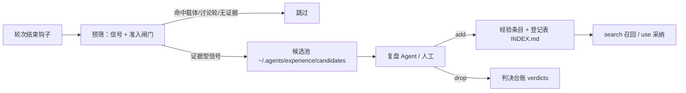

# experience-keeper

把 AI Agent 会话里验证过的做法、踩过的坑和用户的纠正，沉淀成**可检索、可复用**的经验条目，供多个客户端共用。

一次会话只在首次启动做一次复盘：采集由客户端钩子自动落候选，复盘时人工/Agent 判定是否入库，
下次接手同类任务时按现场字样召回。数据全部留在本机 `~/.agents/experience/`，不写仓库、不发网络请求。

## 工作方式



| 环节 | 说明 |
| --- | --- |
| 采集 | 五端钩子在每轮结束解析转录，命中信号才落候选；载体已写入、纯讨论轮、一次性产出直接跳过 |
| 复盘 | 开场 `gate` 派发一次复盘；`review` 按「载体已覆盖 → 待核实 → 过程信号 → 其余」分组 |
| 入库 | 条目带证据链（转录文件与行号），置信度、分类、类型、归属（全局/项目）齐全 |
| 召回 | `search --query/--path/--tool/--error` 按现场字样精确召回；`use` 记录采纳 |
| 维护 | `library` 登记表、`stats` 转正率、`regate` 收紧后复判、`gc` 过期淘汰 |

## 支持的客户端

| 客户端 | 接线方式 |
| --- | --- |
| Codex | `install.py` 写入 `~/.codex/` 钩子与配置 |
| Claude Code | `SessionEnd` 原生钩子 + `settings.json` |
| dsh | cordis 插件 `adapters/dsh/` |
| pi | 扩展 `adapters/pi/` |
| codemaker | 插件 `adapters/codemaker/` |

各端转录解析契约见 [`docs/parsers/`](docs/parsers/README.md)，接线细节见 [`docs/deployment.md`](docs/deployment.md)。

## 安装

```bash
git clone https://github.com/hulinfan/experience-keeper.git ~/.agents/skills/experience-keeper
cd ~/.agents/skills/experience-keeper
python scripts/install.py            # 预演：打印将要做的全部改动
python scripts/install.py --apply    # 写入客户端配置（自动备份）
python scripts/install.py --check    # 只做接线自检，缺项退出码 1
```

要求 Python 3.10+，无第三方运行时依赖（技能目录读取需要 PyYAML>=6.0）。

## 常用命令

| 场景 | 命令 |
| --- | --- |
| 会话开场 | `python scripts/experience.py gate` |
| 查看待复盘 | `python scripts/experience.py review [--all]` |
| 读候选原文 | `python scripts/experience.py show <候选id>` |
| 入库 / 丢弃 | `python scripts/experience.py add --from <id> ...` / `drop <id> --reason carrier\|one_off\|noise\|dup` |
| 检索经验 | `python scripts/experience.py search --query "undefined reference"` |
| 按文件召回 | `python scripts/experience.py search --path tests/unit/test_core.c` |
| 登记表 / 统计 | `python scripts/experience.py library` / `stats` |
| 收紧后复判 | `python scripts/experience.py regate [--apply]` |
| agent 自记备选 | `python scripts/experience.py note --title ... --action ...` |

判据与信号表以 [`docs/experience-prescreen-table-design.md`](docs/experience-prescreen-table-design.md) 为唯一权威，
`SKILL.md` 是 Agent 加载入口。

## 目录结构

```text
experience-keeper/
├── SKILL.md                 # Agent 入口：会话开场、复盘动作、召回时机
├── scripts/
│   ├── experience.py        # 管理 CLI：gate/review/add/drop/library/search/stats/regate/gc
│   ├── experience_hook.py   # 采集入口：解析转录 → 判定信号 → 落候选
│   ├── prescreen.py         # 经验预筛表：信号判定、准入闸门、载体识别
│   ├── transcripts.py       # 五端转录解析
│   ├── experience_lib.py    # 路径、原子写、脱敏、frontmatter、登记表
│   ├── exit_sentinel.py     # 会话结束哨兵
│   └── install.py           # 五端接线与自检
├── adapters/                # dsh / pi / codemaker 插件
├── docs/                    # 设计文档、解析契约、部署说明
├── schema/                  # 候选与条目写入契约
└── tests/                   # 322 个用例，含真实轮次回归样本
```

## 隐私与边界

- 经验与候选只落本机 `~/.agents/experience/`，不写入任何代码仓库、不发起网络请求。
- 凭据形态内容在四个写盘口统一替换为 `[REDACTED]`，命中处数会被打印。
- 条目必须可回溯到转录文件与行号，禁止无证据条目。

## 开发

```bash
pip install -r requirements-dev.txt
python -m pytest tests -q
```

改判定条件时同步三处：`scripts/prescreen.py`、`docs/experience-prescreen-table-design.md`、`tests/test_experience.py`。

## License

[MIT](LICENSE)
