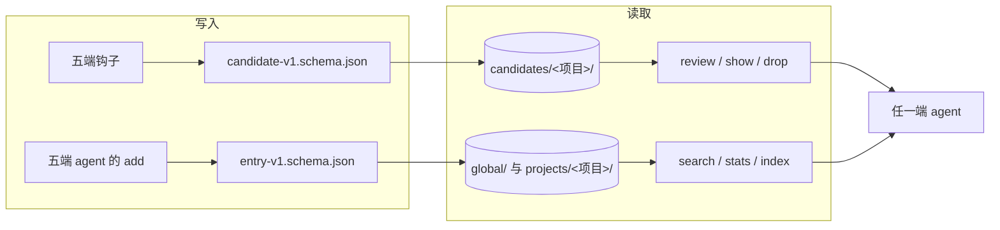
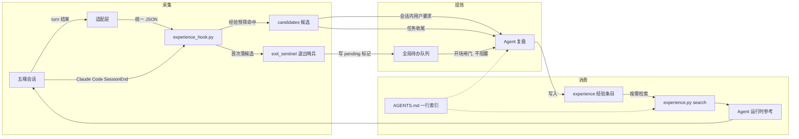
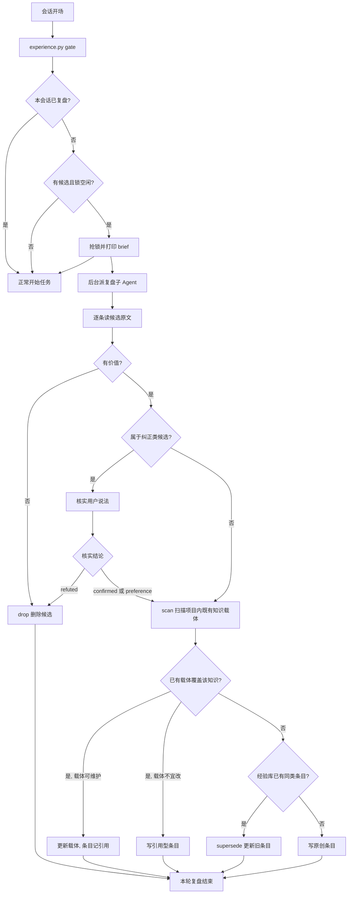
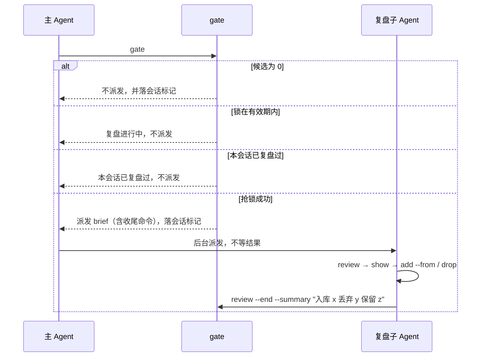
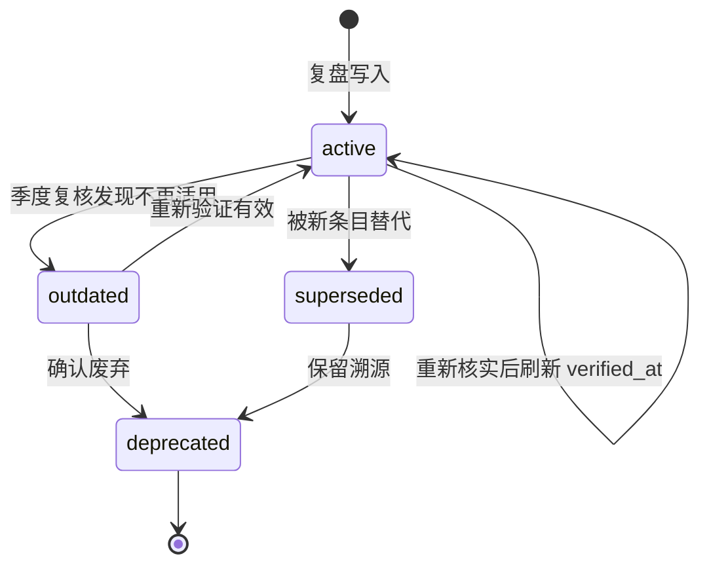

# Agent 经验自动沉淀与跨端共享设计

> 本文随 skill 一起放在 `~/.agents/skills/experience-keeper/docs/`，与实现同处一份拷贝，便于追溯设计方案与决策。
> 方法论来源见同目录 `agent-experience-engineering.md`，五端接线与验证见 `deployment.md`。
> **经验预筛表已独立为核心设计**：`experience-prescreen-table-design.md`，本文不再维护其判定条件。

## 背景

日常在五个 agent 客户端里干活：Claude Code、Codex、dsh、codemaker、pi。其中 dsh、Claude Code、Codex、codemaker 四个已通过符号链接共享同一份全局规则（`~/.agents/AGENTS.md`）和同一套技能（`~/.agents/skills`），pi 原生读 `~/.agents/skills/` 但缺少全局规则文件的链接。**对话里产生的经验没有任何沉淀机制**：排查过的坑、调通的参数口径、验证过的行动顺序，随会话结束一起蒸发，换个客户端或换个项目再从零踩一遍。

本设计新增 `experience-keeper` 能力：五端在每轮结束时自动把有价值的对话片段落成候选，由 agent 在用户发起时提炼为分类经验条目，全局与项目两级存储，五端共用同一份。开场只提示不提炼，用户回复「复盘」才进入提炼。

## 目标与非目标

### 目标

- 五个客户端全部支持自动采集，不依赖 agent 自觉记忆。
- 候选保留对话原文证据，采集不读模型当前上下文，压缩不影响证据完整性。
- 提炼由 agent 完成，不引入额外模型调用与额外 token 成本。
- 经验可按类别与行动类型分类检索。
- 人类对 agent 认知与行为的纠正单独成类、可判定，先核实再决定是否采纳，反复成立的可升级为规则。
- 全局经验与项目经验两级隔离，项目经验按项目自身名称归目录，例如 demo 的经验放 `projects/demo/`。
- 项目级经验优先复用项目内已有的 skill、文档与知识库，命中已有载体时不重复记录。
- 常驻上下文开销只有一行索引，检索按需触发。
- 经验有置信度、生命周期与去重，能标记过时与替代。

### 非目标

- 不做跨机器、跨同事同步，两层经验均仅存本机。
- 不在钩子里调用模型自动提炼。
- 不做向量检索或嵌入召回，检索基于结构化字段过滤与打分。
- 不改动现有 skills 的行为。
- 不采集、不存储任何凭据、令牌与个人信息。

## 设计阶段实测结论

以下结论来自本机实际勘验，是后续设计的依据。

| 结论 | 证据 |
| --- | --- |
| 压缩不改写历史，转录是 append-only | Codex 单条 18MB 会话含 16 次 `context_compacted`（第 396、766 … 5490 行），首次压缩前的 8 条 `user_message` 与 19 条 `agent_message` 仍在文件中 |
| 四端全局规则已是同一份文件 | `~/.dsh/AGENTS.md`、`~/.claude/CLAUDE.md`、`~/.codex/AGENTS.md`、`~/.config/codemaker/AGENTS.md` 均为符号链接指向 `~/.agents/AGENTS.md`，MD5 一致 |
| pi 缺少全局指令文件 | `~/.pi/agent/` 下无 `AGENTS.md`；pi 只读 `~/.pi/agent/AGENTS.md` 与 cwd 链上的 `AGENTS.md`/`CLAUDE.md` |
| pi 原生读 `~/.agents/skills/` | pi 官方 `docs/skills.md` 列出 `~/.agents/skills/` 为技能发现路径 |
| pi 有完整事件钩子 | `docs/extensions.md` 列出 `turn_end`、`session_compact`、`session_shutdown`、`tool_call`、`tool_result` 等；扩展为 TypeScript，全局位置 `~/.pi/agent/extensions/*.ts`，也可在 `settings.json` 的 `extensions` 数组注册绝对路径 |
| codemaker 属 OpenCode 体系 | `codemaker uninstall` 提示卸载 opencode；`~/.config/codemaker/codemaker.json` 含 `plugin` 数组；`codemaker plugin <module>` 可安装插件 |
| 已有跨端归一化先例 | `skills/skill-usage-tracker/` 用同一个 Python 脚本适配 Claude Code、Codex、OpenCode、OpenClaw 四端，含各端部署文档与冒烟测试 |
| Claude 侧 hooks 已占用 | `~/.claude/settings.json` 的 `Stop` 已有两条 hook，`autoCompactEnabled` 为 true |

## 方法论来源

本设计的字段与流程直接取自两篇工程方法论文章。

| 文章方法论 | 本设计实现 |
| --- | --- |
| Trace 清洗为 Trajectory：丢弃基础设施噪声，保留目标、动作、工具参数、观察、错误、恢复、终局与成本 | 候选按白名单字段抽取：用户原话、工具调用与参数、错误原文、终局结果、耗时、工具调用数、token |
| 五类行动经验：工具选择与调用顺序、参数规则与前置条件、反模式、恢复策略、完成判定 | 条目 `type` 字段，五值枚举 |
| `precondition` 硬过滤优先，再按情境打分，而非纯文本相似度 | `search` 先按工具、错误、类别、项目过滤，再按置信度、时效、证据数排序 |
| 召回四时机：任务开始、调用关键工具前、错误或空结果后、准备交付 | 写入常驻索引行的触发条件 |
| 置信度来自支持数与反例数 | 条目记录 `evidence.sessions` 与 `evidence.counters`，按两者比例分 high、medium、low 三档 |
| 单位成功成本优于单次 token | 候选记录 token 与工具调用数，`stats` 输出每条已验证经验的平均会话成本 |
| 生命周期 active → outdated → superseded → deprecated，定期复核 | 条目 `status` 与 `verified_at`，`gc` 执行季度清理 |
| 经验位于模型之外，跨模型与框架可移植 | 纯 Markdown 与 JSONL 文件，五端共用同一份 |
| Prompt Registry：prompt 当代码管，带版本与评分 | `prompt` 类别条目增加 `version` 与 `score` 字段 |
| Incident KB：现象、根因、解法、环境、关联 | `pitfall` 类别正文用现象、根因、解法三段，并有 `related` 互链 |
| ADR：背景、决策、方案对比、理由、影响、验证 | `decision` 类别正文用该模板 |
| SOP 从项目跑出来，清理比新增重要，让消费无感 | 复盘走 skill 执行；`gc` 做季度清理；一行索引让召回无需刻意查找 |
| 同一经验反复出现即升级为团队标准 | 同类人类纠正在 3 个及以上独立会话出现时，由 `promote` 升级为规则写入 `AGENTS.md`，条目转为引用 |

## 采集层的补充来源：letta-ai/trajectory

采集层的工具状态判定另取一处开源实现的做法：[letta-ai/trajectory](https://github.com/letta-ai/trajectory)
（把不同运行时的 agent 会话记录归一化成同一种记录格式的库）。只借它的判定纪律，不引它的代码。

| 采纳的设计思想 | 原文依据 | 本设计落点 |
| --- | --- | --- |
| 来源给出权威结构化结论时才写状态，拿不到就留空 | 「`ok` 只在来源暴露可靠状态时出现，缺则省略；结果文本永不被解释为成功或失败」 | `transcripts.status_from_flag()`：显式布尔 → `ok`/`error`，缺失 → `unknown`；`transcripts.settle_tool()` 统一落库 |
| 文本与判定分离 | 同上 | 文本只进两个证据字段：失败时 `tool.error`（错误原文），状态不可判定且命中错误标记时 `tool.error_text_hint`（封顶 200 字）。删除了原 `_looks_failed()` 文本判失败逻辑 |
| 归一化结果始终带诊断，可恢复的问题显式记录 | 「`diagnostics` 始终存在，无需清理时为空」 | `lib.log_diagnostic()` 把 `normalize`／`parse`／`schema`／`stdin`／`hook` 五类异常写进 `diagnostics/<日期>.jsonl`；正常没命中信号的轮次不记；`experience.py doctor` 汇总 |
| 写入契约带 schema 与运行时校验 | 仓库的 `schema/trajectory-v1.schema.json` 与运行时校验 | `schema/candidate-v1.schema.json` + `lib.validate_candidate()`（标准库实现，支持 schema 用到的关键字）；`experience.py validate` 复核历史候选；枚举与代码常量的一致性由测试锁住 |
| 每个来源一份契约文档，写明输入契约与丢弃内容 | 每个适配器目录一个 README，写清输入契约、解码行为与丢弃项 | `docs/parsers/<client>.md` 五份，统一含「轮次边界／字段来源／工具状态／丢弃内容／已知不可得／兜底与验证」六节，缺失即测试失败 |
| 每个来源的契约要用真实语料核对 | 仓库的 `PARITY.md` 与 `SOURCE_VERSION_AUDIT.md` | 下表按端实测状态字段覆盖，据此决定「缺字段」的语义；`docs/parsers/README.md` 的「新增一端」给出同样的操作步骤（只读统计 → 写契约 → 脱敏样本 → 接线） |
| 缺字段与「非失败」是两件事 | 同上 | 新增 `unknown` 状态；`prescreen` 里 `unknown` 既不顶替 `ok` 也不参与 `error_recovered` |
| 不同来源收敛到同一份记录格式，让任何消费方都能正确识别 | 该库的核心价值：把 15 种运行时的会话记录归一成一种契约，消费方只认契约不认来源 | 两份契约同时约束写入与读取：候选 `schema/candidate-v1.schema.json`、条目 `schema/entry-v1.schema.json`；写入端校验，读取端容错并留痕 |

### 统一格式：让五端都能正确识别

「统一」不是指写在同一块磁盘上，而是指两个方向都只有一份契约：写进来的时候形状一致，读出去的时候解释一致。



| 层 | 契约 | 写入时 | 读取时 |
| --- | --- | --- | --- |
| 候选 | `schema/candidate-v1.schema.json` | 钩子组装后校验：违规记 `schema` 诊断，带归属的照旧落盘不丢证据 | `validate` 复核历史记录；`unknown` 等枚举与代码常量由测试对齐 |
| 条目 | `schema/entry-v1.schema.json` | `add` 写盘前强制校验，违规直接拒绝写入并列出字段路径 | 解析失败的条目记 `entry/unreadable:*` 诊断后跳过，不静默消失；标量字段按单个元素收敛，不让集合运算退化 |

识别保障与对应的失败模式：

| 失败模式 | 现在的行为 |
| --- | --- |
| 某端写出的条目字段类型飘了（`tags: cms` 标量） | 写入端校验拦下；历史条目读取端按 `[cms]` 收敛。修掉了三处会被标量带偏的读取：去重的集合运算（会按字符比较）、检索的 `" ".join(tags)`（会逐字符拼接）、统计的 `len(sessions)`（会数字符个数） |
| 条目 frontmatter 坏掉，别的 agent 读不到 | 记 `entry/unreadable:*` 诊断，`doctor` 与 `validate` 都能看到，而不是静默少一条 |
| 空映射被序列化成字符串 | 已修：`precondition: {}` 按裸映射写出与读回；历史 `"{}"` 由读取端按无前置条件容错 |
| 工具状态被输出文本带偏 | 状态只取结构化字段，缺失记 `unknown`，文本进 `error_text_hint` |
| 枚举值在代码里改了、schema 没跟上 | 4 条测试从源码提取信号名、纠正类型、状态与 outcome，逐个核对 schema 枚举 |
| 候选形状漂移 | `validate` 一次扫全部项目，输出字段路径 |

明确不采纳的部分：不引入该库作为依赖（它是 TypeScript/npm 包，而采集链路是 5 秒超时、
仅用标准库的 Python 子进程）；不用它的记录格式替换候选与条目格式（两者都要带 signal、
correction、cost 这类的领域字段）；它的 15 个来源适配器目录结构对五个端来说属于过度拆分，
本设计按端一个解析函数加一份契约文档即可。

### 五端工具状态字段实测

实测样本取自本机真实转录，用来确定每端「缺字段」的语义。

| 端 | 结构化状态字段 | 实测覆盖 | 缺字段的处理 |
| --- | --- | --- | --- |
| Claude Code | `tool_result.is_error` | 479 条结果：`false` 281、`true` 32、缺键 166；缺键的 166 条都是文件读写、搜索、任务类工具的成功载荷 | 缺键按成功（`absent_means_ok=True`）：失败 32/32 都带该键 |
| pi | `toolResult.isError`、`bashExecution.exitCode` | 175 条结果全部带 `isError`；`bashExecution` 用退出码 | 字段缺失记 `unknown` |
| dsh | 适配器写入的 `is_error`（源自客户端 `block.isError`／`data.error`） | 由本仓库 dsh 适配器保证 | 字段缺失记 `unknown` |
| Codex | 无 | 最近 5 份 rollout 的 23 条 `function_call_output` 只有 `{type, id, call_id, output, internal_chat_message_metadata_passthrough}`，metadata 只含 `turn_id` 与 `create_time` | 一律 `unknown`，文本只留线索 |
| codemaker | `tool.isError` | 主会话 177/177 缺该键，子会话 81/82 缺 | 有则采信，无则 `unknown` |

代价：Codex 与 codemaker 不再产出 `error_recovered`（它们拿不到权威失败状态），候选量下降。
`retry` 基于同名同参数的重复调用，与状态无关，仍然照常命中。

### 不适用之处

人类纠正的判定仍从用户原话出发（`DENIAL_MARKERS`、`REJECTION_MARKERS` 等），这不与上述纪律冲突：
用户原话是纠正的一手证据，不是用来替代结构化字段的猜测；工具成败在多数端有权威字段可用，
才要求只认字段。

## 总体架构



## 存储布局

```text
~/.agents/experience/
├── INDEX.md                               # 经验库登记表：入库/删除/计数变更自动重写，library 直接展示
├── global/<category>/<id>.md              # 全局经验
├── projects/<project-name>/
│   ├── META.json                          # project_root、project_name、首次登记时间
│   └── <category>/<id>.md                 # 项目经验
├── candidates/<project-name>/
│   └── <YYYY-MM-DD>-<client>-<session8>.jsonl   # 待复盘候选，一行一轮
├── verdicts/<project-name>.jsonl          # 候选判决台账：add/drop 与原因，供 stats 算信号转正率
├── pending/<client>-<session8>.json       # 会话结束标记，供开场提示
├── sentinel/<client>-<session8>.pid       # 退出哨兵的 pid，哨兵退出时自删
├── diagnostics/<YYYY-MM-DD>.jsonl         # 采集诊断，一行一次异常，默认留 14 天
└── transcripts/dsh/<session>-t<turn>.jsonl      # dsh 插件落盘的归一化事件流
```

skill 目录下的 `schema/candidate-v1.schema.json` 与 `schema/entry-v1.schema.json` 分别是候选与条目的写入契约，
`docs/parsers/` 是各端转录解析契约。

候选按项目分目录，但消费口径是全局的：`review` 默认列当前项目并提示其他项目的积压，
`review --all` 列全部；`stats` 与 `gc` 的候选口径也是全部项目。

`transcripts/` 只服务 dsh：它的会话日志由持久化后端写成压缩格式，路径拼接属于后端内部实现，插件拿不到可用路径，因此由插件把本轮事件归一化后落盘，再把该文件路径当作 `transcript_path` 交给采集脚本。

候选标识 `<candidate-id>` 定义为 `<YYYY-MM-DD>-<client>-<session8>#t<turn_id>`，例如
`2026-09-22-pi-fixture#t7`。

`verdicts/` 是判决台账：候选被 `add` 或 `drop` 后就从盘上消失，信号好不好没人记得住，
台账按「轮次」记下每条候选的 `signal` 与判决（`add` 带 `entry_id`，`drop` 带 `reason`），
`stats` 据此算每个信号的转正率，低于 `CONVERSION_FLOOR` 的信号进复核队列——
调判据靠这段数据，而不是靠某一次复盘的印象。

候选记录里的 `carrier` 字段（可选）标记本轮把结论写进了哪个项目载体（`AGENTS.md`、
`.harness/rules/**`、`.ai/rules/**`、`.ai-knowledge/**`、`openspec/**`、`**/SKILL.md`）。
有该字段说明结论已经在权威载体里，经验库再记一条只是复述，`review` 把这类候选单列一组，
只需核对载体写全即 `drop`。

项目根取含 `.git` 的最近祖先目录，不存在则取当前工作目录。`project-name` 默认取项目根目录名原样，不做大小写或字符替换：`/work/acme/service` → `service`。

同名目录会撞车，本机已存在 `code\org\gwsvc` 与 `tmp\gwsvc` 两处。消歧规则：写项目经验前先读 `projects/<project-name>/META.json`，若其 `project_root` 与当前项目根不一致，则改用 `<父目录名>-<目录名>`，例如 `tmp-gwsvc`。`META.json` 的 `project_root` 是权威判据，目录名只作索引。

经验数据全部位于 `~/.agents/` 下，不写入任何代码仓库，不受项目 git 影响。

## 数据格式

### 候选（JSONL，一行一轮）

```json
{
  "ts": "2026-09-22T14:03:11+08:00",
  "client": "pi",
  "session_id": "fixture-8a08-7980-addc-3ee42a2ce30e",
  "turn_id": "7",
  "project_name": "demo",
  "cwd": "/work/acme/service",
  "compaction_count": 2,
  "signal": ["error_recovered", "retry"],
  "user": "用户原话，完整保留",
  "assistant": "本轮终局回复原文，超过 2000 字符截断",
  "tools": [
    {"name": "bash", "args": {"command": "..."}, "status": "error", "error": "错误原文"},
    {"name": "bash", "args": {"command": "..."}, "status": "unknown", "error_text_hint": "来源没给状态，这里是命中了错误标记的输出片段"}
  ],
  "outcome": "success",
  "cost": {"tool_calls": 7, "tokens": 12345, "duration_ms": 42000},
  "evidence": {"path": "~/.pi/agent/sessions/.../xxx.jsonl", "lines": [120, 180]}
}
```

字段口径：

| 字段 | 说明 |
| --- | --- |
| `compaction_count` | 本会话内已发生的上下文压缩次数。只用于复盘时判断候选落在哪一段，不影响证据完整性 |
| `signal` | 命中的经验预筛表信号，可多个 |
| `user` / `assistant` | 原文，不做摘要；`assistant` 为终局回复，仅作上下文 |
| `tools` | 本轮工具调用与参数。`status` 取 `called` / `ok` / `error` / `unknown`，只由来源的结构化字段决定；失败时 `error` 存错误原文，状态不可判定且输出命中错误标记时 `error_text_hint` 存线索；输出原文按 1200 字符截断存 `result`。`error` 与 `result` 是判据型信号的取词面（见预筛表设计的「判据取词面」），`status` 不受输出文本影响 |
| `cost` | 墙钟耗时、工具调用数、模型 token 数 |
| `evidence` | 转录文件路径与行号区间，供复盘回溯原文 |

候选有两种来源，共用同一份契约与目录布局：

| 来源 | 写入方 | 标识 | 证据 |
| --- | --- | --- | --- |
| 五端采集 | 轮次结束钩子 | `client` 为端名 | 转录路径与行号区间 |
| agent 自记备选 | `experience.py note` | `client: manual`、`signal: agent_note`，结构化字段放 `note` | 无转录，`evidence.path` 为空，入库后置信度停在 `low` |

自记备选只解决「采集侧看不到 agent 自身的换路」，不解决价值判断：它照样要复盘确认才转条目。

### 经验条目（Markdown，一条一文件）

```markdown
---
id: pitfall-cms-throttling-backoff
title: CMS 查询触发 Throttling 的退避方式
category: pitfall
type: recovery
kind: original
scope: global
project: null
precondition:
  tools: [cms_query]
  errors: [Throttling]
  scene: ops.metric
tags: [cms, throttling, retry]
action: 指数退避重试，单次查询时间窗口收窄到 5 分钟，禁止原参数立即重试
source_of_truth: null
evidence:
  sessions:
    - claude/1c2628c3#turn-4
    - pi/fixture#turn-7
    - codex/fixture#turn-12
  counters: []
  sources:
    - path: ~/.codex/sessions/2026/09/21/rollout-fixture.jsonl
      lines: [396, 420]
cost:
  avg_tool_calls: 7
  avg_tokens: 12345
confidence: high
verification: confirmed
verification_note: 按 CMS 接口文档，Throttling 需退避 30 秒以上，实测第 3 次重试成功
created_at: 2026-09-22
verified_at: 2026-09-22
status: active
supersedes: null
related: []
---

## 现象

（症状原文与复现条件）

## 根因

（确定性原因）

## 解法

（可执行动作，与 frontmatter 的 action 一致）
```

`pitfall` 用现象、根因、解法三段；`decision` 用 ADR 的背景、决策、方案对比、理由、影响、验证六段；其余四类用现象、结论、适用范围与反例三段。

`evidence.sessions` 记录支持该条目的会话，`evidence.counters` 记录与之结论冲突的会话，`evidence.sources` 保存可回溯的转录路径与行号。`cost` 在写入条目时从候选固化，不依赖候选文件长期留存。

`kind` 区分两类条目：

| kind | 含义 | 正文要求 |
| --- | --- | --- |
| `original` | 经验库是该知识的唯一出处 | 写完整内容 |
| `reference` | 项目内已有载体维护该知识 | 不复述载体内容，只写载体位置、章节与本次新增差异 |

引用型条目的 `source_of_truth` 填仓库内相对路径加章节，例如：

```yaml
kind: reference
source_of_truth: skills/elk-query/SKILL.md#索引命名规则
```

`verification` 记录纠正类来源的核实结论，取值与复盘层的核实规则一致：

| 取值 | 含义 |
| --- | --- |
| `confirmed` | 用户说法经独立依据核实成立 |
| `preference` | 属于表达方式或流程习惯等偏好，无客观对错，按用户意愿记录 |
| `n/a` | 非纠正类来源，默认值 |

`refuted` 不出现在条目里：核实不通过的候选不入库。`verification_note` 记录核实依据，非 `n/a` 的条目必须写清依据来自哪条命令、哪段源码或哪份文档，不允许只写结论。

### 分类体系

`category` 与 `type` 是两个正交维度：前者说明经验讲什么，后者说明经验要求做什么。每条经验两个维度各取一个值。

| category | 装什么 |
| --- | --- |
| `pitfall` | 踩坑与恢复 |
| `tooling` | 工具与数据源用法 |
| `workflow` | 有效流程与验证步骤 |
| `decision` | 技术决策与取舍 |
| `prompt` | 与 agent 的协作模式 |
| `domain` | 业务事实与环境口径 |

| type | 经验要求做什么 |
| --- | --- |
| `path` | 工具选择与调用顺序 |
| `tool-rule` | 参数规则与前置条件 |
| `antipattern` | 避免某类做法 |
| `recovery` | 出错后的恢复策略 |
| `completion` | 结果验证与完成判定 |
| `constraint` | 人类明确要求的长期约束，不遵守即为错 |

前五类取自方法论文章；`constraint` 是为人类纠正单独增加的第六类。人类纠正常产出“以后必须这样、不许那样”的长期要求，这类要求不属于任何一类行动经验，没有独立类型就会散落各处、检索不到。

### 纠正类经验的归类

人类纠正分两种对象，落点不同。归类在复盘时确定，不能只按关键词丢进同一类。

| 被纠正的对象 | category | type | 例子 |
| --- | --- | --- | --- |
| 事实认知（组件行为、字段口径、环境差异） | `domain` | `tool-rule` | “NGC 那个字段是下行，不是上行” |
| 做法与顺序（工具选择、排查步骤、验证方式） | `workflow` 或 `tooling` | `antipattern` | “不要先拉全量再过滤” |
| 与 agent 的协作方式（表达、粒度、边界） | `prompt` | `constraint` | “先给结论再给过程” |
| 决策取舍被否 | `decision` | `antipattern` | “这个场景不用缓存方案” |

纠正类条目的正文“现象”段必须引用用户原话，`action` 段写清此后应当怎么做，不允许只写“用户纠正了 X”而不给出可执行版本。

### 归属判定

经验归属全局还是项目，在复盘时按下列顺序判定，命中即停。操作性副本在 `SKILL.md` 的「归属：全局还是项目」，两处必须一致。

| 顺序 | 判据 | 落点 |
| --- | --- | --- |
| 1 | 结论含项目专有标识（仓库名、内部服务或接口名、字段口径、目录、环境别名），剥离后不再成立 | `projects/<项目名>/` |
| 2 | 换个仓库、换套接口或数据源就不成立 | `projects/<项目名>/` |
| 3 | 讲的是与本用户协作的方式（表达顺序、给结论的粒度、边界、验证习惯），与仓库无关 | `global/` |
| 4 | 项目内载体（`docs/`、`skills/`、`kb/`）已维护同一知识 | 项目级加 `kind: reference`；载体本身在全局目录时用 `global/` |
| 5 | 其余：与仓库无关的工具用法、通用排查顺序与验证方式 | `global/` |

判定纪律：拿不准落项目级；同一知识只留一级；全局条目正文不得含项目专有名词；改判需同时移动文件与改 `scope`、`project` 两个字段，只改一处会让位置与字段互相矛盾。

默认值是 `--scope project`；`scope=project` 且未给 `--project` 时，`add` 取 `current_project()` 的项目名自动补齐，避免条目落进无名目录。

## 采集层

### 统一契约

适配层只负责把客户端事件归一化为一段 JSON 并交给同一个 Python 脚本，不读转录、不做判断：

```json
{
  "client": "pi",
  "event": "turn_end",
  "session_id": "...",
  "turn_id": "...",
  "cwd": "...",
  "transcript_path": "...",
  "compaction_count": 2
}
```

脚本按 `client` 进入对应分支解析转录，抽取本轮字段，命中经验预筛表信号后追加候选。该结构与 `skill_runtime_hook.py` 已验证的多端归一化写法一致。解析与写入的异常走两条兜底：

| 环节 | 兜底 |
| --- | --- |
| 解析不出内容 | 返回 `None`，记 `parse/no_transcript` 诊断，不落候选 |
| 事件名不认识 | 跳过并记 `normalize/unknown_event:*` 诊断 |
| 组装结果违反 schema | 记 `schema` 诊断，带 `project_name` 的照旧落盘，不因校验丢证据；连归属都没有的直接丢弃 |
| 采集入口抛异常 | 记 `hook/exception:*` 诊断后以 0 退出，不影响客户端轮次结束 |

正常但没有命中信号的轮次（`no_signal`）不记诊断：诊断只装异常，否则「没经验可沉淀」与「解析器坏了」会被混在一起。`experience.py doctor` 汇总最近若干天的诊断与候选现状。

### 五端适配

| 端 | 采集挂载点 | 触发事件 | 转录来源 |
| --- | --- | --- | --- |
| Claude Code | `~/.claude/settings.json` 的 `hooks.Stop` 数组追加一项；另在 `hooks.SessionEnd` 追加同一命令 | `Stop`、`SessionEnd` | `transcript_path` |
| Codex | `~/.codex/config.toml` 的 `[[hooks.Stop]]` | `Stop` | `transcript_path`，按 `turn_id` 定位本轮 |
| dsh | `~/.dsh/.agent-presets/liangshen/` 新增插件行 | `session/event` 中的 `turn/end` 与 `compaction/end` | 插件落盘到 `transcripts/dsh/` 的归一化事件流 |
| codemaker | `~/.config/codemaker/codemaker.json` 的 `plugin` 数组注册插件路径 | `session.idle` | `~/.codemaker/session-store/v1/<hash>/<uuid>.json` |
| pi | `~/.pi/agent/settings.json` 的 `extensions` 数组注册扩展绝对路径 | `turn_end`、`session_compact`、`session_shutdown` | `~/.pi/agent/sessions/--<path>--/<ts>_<uuid>.jsonl` |

采集时机固定为轮次结束，不放在会话终止：压缩需要累积到接近上下文上限才触发，逐轮落盘的内容在压缩发生前已在磁盘上。转录本身是 append-only 追加写入，压缩只追加一条摘要记录，压缩前的原始条目仍在文件中，因此候选保存的原文证据不受压缩影响。会话结束只写一份标记（原生 `SessionEnd` 钩子或退出哨兵），不解析转录、不写候选。

`compaction_count` 记录候选产生时本会话已经压缩过几次，取值规则按端区分：

| 端 | `compaction_count` 来源 |
| --- | --- |
| Codex | 转录中的 `context_compacted` 事件计数 |
| pi | 转录中的 `compaction` 条目计数（扩展另按 `session_compact` 累加，两者语义一致） |
| dsh | 归一化事件流里的 `compaction` 事件计数 |
| Claude Code | `isCompactSummary is True` 的摘要记录计数 |
| codemaker | `compression.totalCompressionsCount`，缺失时退回 `compression.compressionHistory` 长度 |

它只是位置标记，不参与任何判定。取不到时记 0，不影响证据完整性，只影响复盘时能否按压缩边界分段阅读：数值大于 0 说明 agent 当时看到的是压缩摘要而非完整对话，复盘应回到 `evidence.sources` 的原文行号核对。

### 经验预筛表

> **本节内容已全部收归 `experience-prescreen-table-design.md`**（核心设计，唯一权威）：
> 信号清单与触发条件、人类纠正的判定、可复用闸门、分层、工程域触发点、误报控制。
> 本节只保留它在总体流程里的位置说明，判定条件不在本文复述。

命中任一信号才落候选，避免全量写入。信号清单与判定见核心设计文档。

### 幂等与并发

候选以 `session_id + turn_id` 为唯一键。写入流程为：加文件锁、读取现有候选文件、按唯一键合并本轮记录、写临时文件、原子替换目标文件。重复触发同一轮只保留一行，不产生重复记录。文件锁为 Windows 与 Unix 双平台兼容实现，沿用 `skill_runtime_hook.py` 的 `_FileLock`。

读改写的锁作用域有两条硬规矩，违反任意一条都会静默吞掉别人的候选：

1. **先读后写的整段待在锁里。** 消费候选（`drop`、`add --from`、`gc --apply`）一律走 `lib.consume_candidate` / `lib._rewrite_candidate_file`：锁内重新读取、按 `turn_id` 重新定位、再整体重写。行号是易变事实，跨过一次加锁写入就会指错行。
2. **锁文件永不删除。** 删掉正在被别人等待的锁文件，会让等待者锁住旧 inode、新来者锁住新文件，互斥当场失效。它是零字节常驻文件。

锁用非阻塞方式反复试拿，默认 3 秒（`FileLock.DEFAULT_TIMEOUT_SEC`）：钩子路径上是先等锁再落盘，拿不到就记一条 `lock/lock_timeout` 诊断后放弃，绝不阻塞客户端轮次结束；`note` / `consume_candidate` 拿不到锁直接带原因失败，不装作写成功。诊断日志是旁路，等锁上限压到 0.2 秒，丢了不影响采集。

## 复盘层

### 触发

提炼必须占用一次模型回合，而五端唯一通用的退出钩子只能执行旁路命令，因此提炼不挂在退出路径上，也不由 agent 自行判定「用户不着急」而启动。开场不构成授权，三个入口：

| 入口 | 场景 | 行为 |
| --- | --- | --- |
| 会话内显式 | 用户说「沉淀一下」「把这条记下来」 | 当场复盘或当场 `add`；没有候选时用 `add --manual`，置信度强制 `low` |
| 会话内收尾 | 一轮任务收尾且用户点头 | 同上 |
| 开场闸门 | 会话开场，一次会话只此一次 | 主 Agent 跑 `experience.py gate`：候选为 0、复盘进行中或本会话已复盘过就不派发；抢锁成功才后台派复盘子 Agent，brief 由 `gate` 打印，主 Agent 不等待、不读候选正文 |
| 用户显式复盘 | 用户说「复盘」 | 主 Agent 自己按 SKILL.md 的复盘动作走一遍，不派子 Agent |

开场检测必须零成本：`gate` 只读候选目录、不解析转录；候选为 0 时直接返回，不派发、不烧 tokens。
有候选时它抢锁并打印派发 brief，主 Agent 原样转发给后台子 Agent，自己立刻处理用户任务。跨项目积压
与最近结束的会话仍由 `prompt` 汇总，`prompt` 不再负责派发。

一次会话只复盘一次：`gate` 把会话标识写进 `.session-review.json`，同会话再跑（复盘结束、会话中途
又冒出候选）只回「本会话已复盘过」；会话退出（客户端进程结束或会话 id 变化）后标记失效。开场无候选
同样算用掉这一次，避免会话中途的候选反复占用复盘成本。

会话结束标记由两处写入，都不调用模型：Claude Code 的原生 `SessionEnd` 钩子，以及其余四端的退出哨兵。



`review` 默认只列当前项目的候选，不读取其他项目的候选目录；其他项目有积压时只打印条数提示。经验归属全局还是项目，由复盘时判断：跨项目通用写 `global/`，只适用当前项目写 `projects/<project-name>/`，判据见「归属判定」。

### 退出哨兵

没有会话结束事件的客户端（Codex、dsh、codemaker、pi）由哨兵补标记：采集脚本在第一次落候选时派生一个脱离父进程的 `exit_sentinel.py`，哨兵沿父进程链认出客户端主进程并等它退出，退出后写 `pending/<client>-<session8>.json`。

| 设计点 | 取值 | 理由 |
| --- | --- | --- |
| 识别方式 | 先按客户端进程名精确匹配，`pi`/`dsh`/`codemaker` 再退到宿主运行时 `node`/`bun`/`deno` | Claude Code 有原生 `SessionEnd`，认错进程只会写假标记，因此不参与宿主兜底 |
| 等待方式 | Windows 用 `OpenProcess(SYNCHRONIZE)` + `WaitForSingleObject`，POSIX 每 2 秒 `kill(pid, 0)` | Windows 不轮询；POSIX 无事件接口，2 秒粒度足够 |
| 工作目录 | 钉在 `scripts/` | 哨兵活到会话结束，占住项目目录会让 Windows 无法改名或删除该目录 |
| 认不出客户端 | 不派生 | 宁可没有标记，也不能把「钩子进程退出」误判成「会话结束」 |
| 幂等 | 同一会话一个哨兵，pid 文件在 `sentinel/` | 每轮都派会堆进程 |
| 兜底失败 | 整棵进程树被强杀时没有标记 | 候选已逐轮落盘，开场 `review` 照样能看到

### 复用优先

项目里往往已经有知识载体：既能是 skill 的 `SKILL.md` 与 `references/`，也能是 `docs/` 说明、`README.md`、`openspec/specs/` 或项目自己的知识库目录。项目级经验写入前必须先扫描这些载体，命中同一知识点时不得把内容抄进经验库，避免同一事实两处维护、两份说法逐渐分叉。

扫描由 `experience.py scan` 完成，输出载体清单：路径、标题、命中行，覆盖范围与优先级如下。

| 载体 | 扫描位置 |
| --- | --- |
| 项目 skill | `.agents/skills/*/SKILL.md`、`.pi/skills/*/SKILL.md`、仓库内 `skills/*/SKILL.md` 及其 `references/` |
| 项目文档 | `docs/**/*.md`、`README.md` |
| 需求与规范 | `openspec/specs/**/spec.md`、`openspec/project.md` |
| 项目知识库 | 仓库内已有的 `kb/`、`knowledge/`、`wiki/` 等目录 |

命中后有两条处理路径：

| 情形 | 处理 |
| --- | --- |
| 载体是 skill、references 或文档等本就该长期维护的文件 | 直接更新载体，经验条目只记引用指针与本次新增的差异点 |
| 载体是外部系统导出、生成产物或不宣改动的内容 | 写引用型条目，正文不复述载体内容，只写适用条件与差异 |

两条路径都必须在条目里写明载体位置与章节，凭此回溯源。载体已经覆盖且本次无新增信息时，不写条目，直接把候选 `drop`。

### 纠正的核实

用户否决 agent 的方案，不等于用户正确。把未核实的否决直接写成经验，会让错误结论以“用户说的”为名义固化，甚至升级成全局规则，破坏面比不记录更大。因此纠正类候选在入库前必须核实，核实是强制前置，与复用优先的 `scan` 并列。

核实手段按可判定性选择，优先选能给出独立依据的方式：

| 核实手段 | 适用纠正 | 判定依据 |
| --- | --- | --- |
| 可执行验证 | 命令、参数、路径、SQL、接口调用、字段口径 | 实际跑一次只读验证，看哪一方与运行结果一致 |
| 代码与配置查证 | 代码行为、配置项、组件语义 | 源码位置、配置文件、官方文档的确定性依据 |
| 数据查证 | 数据口径、字段含义、取值范围 | 实际数据样本或表结构 |
| 历史证据对照 | 与已有经验条目结论冲突 | 读已有条目的原文证据，比较哪一方证据更新 |

核实必须给出独立于双方主张的依据，不允许以“我原来的做法也没错”作为依据。核实全程只允许只读操作，单个候选有固定时间预算，超出预算即按偏好处理。

核实结论三态：

| 结论 | 处理 |
| --- | --- |
| `confirmed` | 用户正确，正常入库，条目记 `verification: confirmed` 与核实依据 |
| `refuted` | 用户说法有误，**不入库**，不得计入置信度；核实依据留档在候选里，同一误解复现 2 次及以上时才另立 `type: antipattern` 条目，只写误解内容与依据，不写对人的评价 |
| `preference` | 属于表达方式、粒度、流程习惯等偏好，无客观对错 | 不判对错，按用户偏好入库，条目记 `verification: preference` |

找不到独立依据时必须落到 `preference`，不得判 `refuted`。判定 `refuted` 必须附一条可复现的反证（一条命令、一段源码、一行数据），只写“判断用户不对”不算核实。

### 去重与置信度

去重判定使用确定性规则，不做模糊匹配：标题归一化（去首尾空格、连续空白压成一个、转小写）后完全相等，或 `tags` 交集达到 2 个及以上，即视为同一经验。

| 情形 | 处理 |
| --- | --- |
| 命中去重规则 | 走 `supersedes` 更新已有条目，不新增 |
| 新证据补充已有条目 | 追加 `evidence.sessions`，刷新 `verified_at` |
| 新证据与已有条目结论冲突 | 追加 `evidence.counters`，按下方规则重算置信度 |
| 纠正类证据未经核实，或核实结论为 `refuted` | 不计入 `evidence.sessions`，不参与置信度计算，也不参与升级门槛判定 |

置信度按支持会话数与反例会话数计算，对应方法论中的“支持数 /（支持数 + 反例数）”：

| 条件 | confidence |
| --- | --- |
| 支持会话数 ≥ 3，且反例会话数为 0 | `high` |
| 支持会话数 ≥ 2，且反例会话数 ≤ 支持会话数的一半 | `medium` |
| 其余情况 | `low` |

反例存在时必须在正文的“适用范围与反例”段落写明反例条件，不允许只降置信度而不记录反例。

### 反复纠正的升级出口

人类纠正的经验不能只躺在经验库里等人检索。同一条纠正被反复提出，说明它不是偶发分歧，而是本来就该固化的规则。判定门槛沿用方法论文章的“反复使用 3 次以上升级为标准”：

| 条件 | 处理 |
| --- | --- |
| 同类纠正出现在 3 个及以上独立会话，且这些会话全部核实为 `confirmed` 或 `preference` | 触发升级，产物是规则而不是条目 |
| 同类纠正出现在 2 个会话 | 保持条目，`confidence: medium` |
| 仅 1 个会话 | 保持条目，`confidence: low` |
| 支持会话中存在未核实或 `refuted` 的纠正 | 不升级，先补齐核实 |

升级由 `experience.py promote <id>` 执行，它只输出待追加的规则文本，不直接改文件：

| 经验范围 | 规则追加位置 |
| --- | --- |
| 全局约束（`scope: global`） | `~/.agents/AGENTS.md` 的“经验沉淀出的规则”小节 |
| 项目约束（`scope: project`） | 项目根 `AGENTS.md`；无该文件时写项目内 `.agents/rules.md` |

追加必须经用户确认后执行，agent 不得自行修改全局规则文件。追加完成后，原条目转为 `kind: reference`，`source_of_truth` 指向规则所在文件的章节，正文不再重复规则内容，与本设计的复用优先原则一致。

规则小节的内容同样是经验，会在后续会话中继续被验证：若某条规则被证明不适用，先删规则，再把条目退回 `original` 并记录反例。

## 召回层

### 开场闸门与复盘 Agent

开场只跑一条命令 `gate`，它同时做四件事：数候选、判有没有人在复盘、判本会话是否已复盘、抢锁并打印派发 brief。



防套娃靠机械闸而不是模型自觉：锁在派发前由主 Agent 抢下，复盘期间任何进程（包括子 Agent 自己）
再跑 `gate` 都只会读到锁。五层叠加：

| 层 | 机制 | 拦住什么 |
| --- | --- | --- |
| L1 文本 | 常驻第一条写「仅主 Agent 派发」 | 模型读到入口就想再派 |
| L2 brief | `gate` 打印的固定 brief，含「不派发任何子 Agent」 | 子 Agent 自行发挥 |
| L3 锁 | `.review.lock`（pid + 时间戳，TTL 15 分钟），派发前 O_EXCL 创建 | 并发开窗、嵌套复发 |
| L4 命令面 | 锁有效期内 `gate` 只输出「复盘进行中」 | 换命令再触发一次 |
| L5 会话 | `.session-review.json` 记会话标识，同会话只派发一次 | 复盘结束后、换轮次再触发 |

子 Agent 的权限边界：可 `add --from`、可 `drop` 候选、可保留；不可删条目（`remove` 只由用户发起）、
不可 `promote` 改规则文件、单轮最多处理 5 条、拿不准必须保留。收尾时 `review --end` 把一行统计追加到
`reports/<日期>.md` 并释放锁；子 Agent 只把这一行回给主 Agent，候选正文不进主上下文。

锁崩溃残留由 TTL 兜底：超过 15 分钟的锁按无锁处理，读取时顺手清掉。

会话标记同样只认当前会话：pid 型标记靠客户端进程存活判断，会话 id 型标记靠 id 比对；标记超过
72 小时按过期处理，防止 pid 复用把闸门长期关掉。

### 常驻索引行

追加到 `~/.agents/AGENTS.md`，五端通过各自的符号链接同时生效。索引段的权威文本在
`~/.agents/skills/experience-keeper/scripts/install.py` 的 `INDEX_SECTION`，文件里粘贴的是同一份内容。
小节与规则文件前面几节同构：四字标签加约束，一句一条，无引言。常驻只保留四条——复盘闸门（含开场闸门
命令与派发规则）、按需加载、沉淀入口、登记表触发词；命令写法、brief 全文、检索打分全部落在按需加载的
`SKILL.md`：

```markdown
## 经验库

- 复盘闸门：会话开场跑 `python "$HOME/.agents/skills/experience-keeper/scripts/experience.py" gate`；一次会话只复盘这一次，直到会话退出都不再复盘；它说派发就后台派复盘子 Agent（原样转发 brief），仅主 Agent 派发
- 按需加载：不通读条目；接手任务、调工具前、报错或空结果后、交付前，按现场字样（报错原文、工具名、接口名、路径）`search` 召回，命中才读
- 沉淀入口：用户说「沉淀一下」「记下来」时，读 `~/.agents/skills/experience-keeper/SKILL.md` 入库
- 登记表：用户问「经验库有哪些经验」「列出完整经验库」「查询经验召回情况」「查询经验复用情况」时跑 `python "$HOME/.agents/skills/experience-keeper/scripts/experience.py" library`，原样展示表格
```

### 检索打分

先做硬过滤，再排序，取前 5 条。

```text
硬过滤：显式指定的 category / type / scope / project 必须匹配；
        precondition 中指定的维度（tools、errors、scene）不匹配则排除。

score = 3 * precondition 命中维度数
      + 2 * 置信度权重(high=3, medium=2, low=1)
      + 1 * 时效(verified_at 距今 <= 90 天)
      + 1 * min(支持会话数, 3)
      - 2 * min(反例会话数, 2)
```

### 召回计数与采纳计数

两个口径分开记，因为可观测性差一截：

| 字段 | 写入口 | 语义 | 可观测性 |
| --- | --- | --- | --- |
| `hit_count` / `last_hit_at` | `search` 命中并展示 | 条目被检索到 | 机械信号，覆盖满 |
| `use_count` / `last_used_at` / `last_use_result` | `use <id> --result ok\|failed` | agent 声称按这条执行过 | 自报，会漏报也会虚报 |
| `use_failed_count` | `use --result failed` | 执行了但结论没解决 | 同上 |

检索计数落在检索路径上，因为它机械可得；执行与否只有 agent 自己知道，所以要一个显式写口。
早期版本把两者压在 `use_count` 一个字段上，只能靠一句「被召回不等于被执行」提醒读者自己打折；
现在把不可验证的那半截单独隔离成自报字段，机械信号不退化。

```text
召回计数条件：--query / --path / --tool / --error 任一存在，且条目进入结果列表
不计数：      --query 留空的清单用法、--path 的「可能相关」段、--no-count、其余维护命令
采纳计数条件：显式执行 use <id>，一次一条；--result 缺省 ok，失败也计入并落 use_failed_count
```

写盘纪律：库级锁内重读条目再原子替换，避免与 `add --force`、`promote` 的改动互相覆盖；
等锁上限 1 秒。召回计数失败（锁超时、文件不可写）只落一条 `recall/count_failed` 诊断并在 stderr
提示一行，检索结果照常输出——它是旁路，不允许挡住召回。采纳计数是主路径：写失败落
`use/count_failed` 诊断并退出码 1，自报信号写不进去必须让 agent 看见。

存量迁移：变更前的条目没有 `hit_count`，旧 `use_count` 记的是召回次数。读路径分开处理
（`hit_count()` 回落旧字段，`use_count()` 对存量条目返回 0）；首次写盘（search 命中或 `use`）时把旧值
搬进 `hit_count`、`use_count` 归零，不需要单独的迁移命令。

口径边界要写清楚：`hit_count > 0` 证明被检索到，`use_count > 0` 证明 agent 声称执行过，
两者都不证明结论正确且有效，判断真经验要结合 `evidence.sessions` 与 `verification`。
采纳不刷新 `verified_at`：复核必须是刻意动作，不能靠自报逃过 90 天复核。

### 经验库登记表

`INDEX.md` 一张表覆盖全局与所有项目，`library` 打印它；`index` 只重建文件不打印表格。

| 列 | 来源 | 说明 |
| --- | --- | --- |
| 经验条目名 | `title` + `id` | id 供 `use` / `remove` 使用 |
| 描述 | `action`，缺失取正文首句 | 超过 80 字截断；竖线转义、换行折空格，防止撑坏表格 |
| 类别/类型、置信度 | frontmatter | 判断可信度用 |
| hit_count、use_count | 计数字段 | 口径见上两节 |
| 所属项目 | `scope` + `project` | 全局条目写「全局」 |

同步点：`add`、`remove --apply`、`search` 计数、`use` 写盘后各重写一次；写失败落诊断并只在 stderr
提示一行，不反向阻断条目写入。删除作用于多端共享资产，命令默认预演，`--apply` 才落盘。

### 命令

```bash
python experience.py gate                      # 开场闸门：本会话未复盘、有候选且锁空闲时打印派发 brief 并抢锁
python experience.py review --end --summary "入库 x 丢弃 y 保留 z"   # 复盘收尾：写记录并释放锁
python experience.py prompt                    # 开场提示行（库里有什么）；不负责派发
python experience.py review                    # 列当前项目候选 + 全局积压提示
python experience.py review --all              # 列所有项目的候选，按项目分组
python experience.py doctor                    # 采集体检：最近诊断 + 候选与条目现状
python experience.py validate                  # 按 schema 校验已有候选；有问题退出码 1
python experience.py show <candidate-id>       # 打印候选原文
python experience.py note --title "..." --action "..." --root-cause "..."  # agent 自记备选，先落候选不入库
python experience.py scan --query "..."        # 扫描项目内已有知识载体，避免重复记录
python experience.py add --from <candidate-id> # 从候选创建条目
python experience.py add --manual              # 无候选当场沉淀；无转录证据，置信度强制 low
python experience.py drop <candidate-id>       # 丢弃无价值候选
python experience.py promote <id>              # 输出待追加的规则文本，由用户确认后追加
python experience.py search --query "..." [--category pitfall] [--scope project]
python experience.py use <id> [--result ok|failed] [--note "..."]   # 记采纳：自报口径，与召回计数分开
python experience.py library                   # 展示登记表：条目名、描述、hit/use、所属项目
python experience.py use <id> [--result ok|failed] [--note "..."]   # 记采纳：自报口径，与召回计数分开
python experience.py remove <id> [--apply]     # 删除条目：默认预演，--apply 落盘并同步登记表
python experience.py index                     # 重建登记表 INDEX.md
python experience.py gc --older-than 90d       # 清理全部项目的候选、失效标记与过期条目
python experience.py stats                     # 输出度量
python ../install.py --check                   # 五端接线自检，缺项退出码 1
```

## 生命周期与度量



`stats` 输出：

| 指标 | 口径 |
| --- | --- |
| 条目总数 | 按 category、type、scope 分组计数 |
| 置信度分布 | high / medium / low 占比 |
| 独立会话覆盖 | 支持会话与反例会话的数量，衡量经验是否真被复用 |
| 召回次数 | `hit_count` 累加值、被召回条目数、零召回条目数与 Top 5 榜单，衡量条目是否真被检索到 |
| 采纳次数 | `use_count` 累加值、被采纳条目数、`use_failed_count` 与采纳率 `use/hit`，衡量 agent 是否真按条目执行 |
| 待复盘候选积压 | candidates 目录条数与最老时间 |
| 过期条目 | `verified_at` 超过 90 天的条目数 |
| 平均会话成本 | 条目 `cost` 字段的工具调用数与 token 均值 |

## 五端接线清单

| 步骤 | 动作 |
| --- | --- |
| 1 | 五端规则文件均为指向 `~/.agents/AGENTS.md` 的符号链接：`~/.dsh/AGENTS.md`、`~/.claude/CLAUDE.md`、`~/.codex/AGENTS.md`、`~/.config/codemaker/AGENTS.md`、`~/.pi/agent/AGENTS.md`。副本与指向别处的一律重建，不用硬链接兜底（全局规则走原子替换，硬链接会被打断并留下过期副本） |
| 2 | 在 `~/.agents/AGENTS.md` 追加索引段；已存在但为旧版时只替换「## 经验库」小节 |
| 3 | 把 skill 目录整体放到 `~/.agents/skills/experience-keeper`（实体目录，不建链接；脚本与适配器都按自身位置或 home 推导路径） |
| 4 | Claude Code：向 `~/.claude/settings.json` 的 `hooks.Stop` 与 `hooks.SessionEnd` 各追加一项，不覆盖已有记录 |
| 5 | Codex：向 `~/.codex/config.toml` 追加 `[[hooks.Stop]]`，位置必须在原有 Stop 块之后、`[hooks.state]` 之前，否则已信任钩子的下标会被顶位 |
| 6 | dsh：把 `adapters/dsh/experience-keeper.mjs` 复制进 `~/.dsh/.agent-presets/liangshen/`，并在 `agent.cordis.yml` 追加插件行 |
| 7 | codemaker：把 `adapters/codemaker` 路径加入 `~/.config/codemaker/codemaker.json` 的 `plugin` 数组 |
| 8 | pi：把 `adapters/pi/experience-keeper.ts` 绝对路径加入 `~/.pi/agent/settings.json` 的 `extensions` 数组 |

上述八步由 `scripts/install.py` 一次完成，默认预演，`--apply` 才写入，每次改动前自动备份。安装动作只追加配置项，索引段之外的已有内容不改；配置里已有指向别处的采集钩子时按路径替换，不产生重复项；`--check` 逐项自检接线，缺项退出码 1。每一步完成后用对应的冒烟测试验证候选落盘。

skill 真身放全局目录 `~/.agents/skills/experience-keeper/`，不放进任何代码仓库，也不为它建链接。

## 安全与隐私

- 经验与候选仅存本机 `~/.agents/`，不进入任何仓库、不发起网络请求。
- 抽取时对 `token`、`password`、`secret`、`api_key`、`authorization` 等键与形如长随机串的值做脱敏替换，替换为 `[REDACTED]`。
- 脱敏是写入侧的强制步骤，覆盖四个落盘入口：采集钩子写候选、`note` 写备选、`add` 写条目、`promote` 写规则文本。取候选复用时（`add --from`）对读到的候选再洗一遍，历史候选不受旧口径影响。拦截点必须在这里，不能放在复盘环节：`drop` 只删引用，明文在落盘那一刻就已经进磁盘。
- 识别范围覆盖现场字样：provider 前缀令牌（`AKIA`、`ASIA`、`LTAI`、`sk-`、`sk-proj-`、`ghp_`、`glpat-`、`xoxb-`）、JWT 三段、`Bearer`/`Basic` 头、`PGPASSWORD=…` 这类 `key=value` 赋值、PEM 私钥整块，以及同时含大小写与数字的长随机串。纯十六进制的 commit 号不脱敏，保留证据可回溯。
- 脱敏必须留痕：候选记录带 `redactions` 计数，`note`/`add` 在标准输出打印命中处数。用户要能分辨「本来就没写凭据」与「凭据已经被替换掉」，否则脱敏就成了静默篡改。
- 候选保留原文，落地时限制单字段长度，避免整段日志灌入。
- 复盘写入条目前复核一遍正文，凭据形态内容不得进入条目。
- 采集脚本单次执行固定超时，超时静默退出，不阻塞客户端轮次结束。

## 测试

### 单元测试

- `project-name` 归属：`demo` 归 `projects/demo/`；两处同名 `gwsvc` 时第二处按 `META.json` 的 `project_root` 判定为 `tmp-gwsvc`；`META.json` 缺失时按首次登记写入。
- 经验预筛表判定：原六条信号各自命中与不命中，多信号并存；扩充后的表见 `experience-prescreen-table-design.md`。
- 自记备选：`note` 只落候选不写条目、候选通过 schema 校验、`review` 可见、`add --from` 补齐前置条件与标签且置信度停在 `low`、无 `--action` 时报错退出。
- 规则文件链接：五种状态（`linked` / `elsewhere` / `copy` / `drift` / `missing`）各自判定正确；副本与指向别处的链接重建前先备份；`--check` 能把内容漂移的副本判为待修。
- 人类纠正判定：六种方式各自单独命中；同一轮同时出现显式否定与直接给答案时两个信号都记录。
- 纠正归类：四种被纠正对象分别落到预期的 category 与 type，协作方式类落 `constraint`。
- 升级门槛：同类纠正在 1、2、3 个独立会话下的三种处理；`promote` 只输出规则文本，不修改任何文件。
- 核实结论：`confirmed`、`refuted`、`preference` 三态的判定与落库路径。
- 核实兜底：找不到独立依据时强制落 `preference`，不得判 `refuted`。
- 核实拦截：`refuted` 候选不入库、不计入 `evidence.sessions`；存在未核实支持会话时 `promote` 拒绝升级。
- 转录解析：五端各自的样本文件解析出正确的轮次边界与字段。
- 工具状态权威性：输出文本命中错误标记（`12 passed, 0 failed`、日志里的 `Traceback`）不得改变 `status`；结构化字段存在时压过文本；Claude Code 缺 `is_error` 判成功；pi 的 `bashExecution` 按 `exitCode` 判定、缺失记 `unknown`；`unknown` 不计入 `error_recovered`；状态不可判定时只留 `error_text_hint`，`error` 保持为空。
- 采集诊断：`parse/no_transcript`、`normalize/unknown_event`、`stdin` 读取失败都会落一行诊断；正常没命中信号的轮次不落；`doctor` 汇总与明细可读；`gc` 清理超期诊断。
- 候选 schema：合法记录零问题；缺必填字段、枚举越界、类型不符、文本线索超长都能定位到字段路径；`validate` 对坏候选退出码 1；schema 枚举与 `CLIENTS`、`STATUS_*`、prescreen 产出的信号名和纠正类型逐一对齐。
- 契约文档齐备：五端各有一份且含六个小节，索引页列出全部。
- 条目契约：`add` 写出的条目零问题；空映射往返仍是映射（`precondition: {}` 不被转义成字符串）；标量 `precondition`/`tags` 不产生误命中与误判重；`add` 遇校验失败拒绝写入；坏条目在 `iter_entries` 里留诊断而不是静默跳过；`validate` 对坏条目退出码 1 并给出字段路径。
- 候选幂等：同一 `session_id + turn_id` 重复触发只保留一行；8 个进程同时追加同一轮仍只留一行。
- 锁作用域：`drop` 一条候选不动同文件里的其他候选（按 id 定位，不按行号）；候选被消费掉后再消费返回「已不在」而不是报错；锁被其他进程占住时 `note` 快速失败且不写入；跨进程互斥真实生效（占用者在子进程里时本进程拿不到锁）。
- 脱敏：含 token、password 的字段与值被替换；`AKIA`/`sk-proj-`/JWT/`PGPASSWORD=…`/PEM 私钥都整段替换；纯十六进制 commit 号不被误伤；正常中文描述不被误伤；`note` 与 `add` 的落盘内容不含凭据；脱敏命中处数在候选 `redactions` 与命令输出里可见。
- 检索打分：硬过滤、排序、top 5 截断、反例扣分。
- 置信度分档：支持数与反例数的组合覆盖 high、medium、low 三档。
- 去重判定：标题归一化后相等、`tags` 交集达到 2 个、两者都不满足三种情形。
- `scan`：命中项目 skill、`docs/`、`openspec/specs/` 三类载体并返回命中行。
- 引用型条目：`kind: reference` 必须带 `source_of_truth`，正文不得复述载体内容。
- `add --manual`：未填证据时强制降为 `low`；与 `--from` 同用直接报错。
- `review --all`：列出全部项目的候选并按项目分组；默认视图在其他项目有积压时打印条数提示。
- `prompt`：无积压时零输出；有积压时只输出一行，含当前项目条数、其他项目条数、最近结束的会话；不得带出候选正文。
- `gate`：候选为 0 → 不派发、不建锁、落会话标记；候选 > 0 且锁空闲 → 抢锁并打印 brief；锁有效期内 → 只回「复盘进行中」；本会话已复盘过 → 只回「本会话已复盘过」；过期锁按无锁处理并可被清理。
- `review --end`：把一行统计追加到 `reports/<日期>.md` 并释放锁；无锁时照常记录。
- 全局候选口径：`stats` 的 `pending_candidates_all` 与 `gc` 覆盖全部项目。
- 会话结束标记：同一 `(client, session_id)` 重复写只留一份；候选已消费完的标记在下次 `review` 时被清理。
- 退出哨兵识别：父进程链上按客户端进程名精确匹配，`pi`/`dsh`/`codemaker` 可退到宿主运行时；Claude Code 不参与宿主兜底；认不出客户端时不派生。
- 退出哨兵等待：观察真实子进程退出返回真；`spawn` 的哨兵工作目录不落在项目目录。
- `gc`：候选按时间清理，条目按状态与时效转移。

### 场景测试

1. 一轮出现错误后恢复，落盘候选带 `error_recovered`，并派生一次退出哨兵。
2. 一轮无任何信号，不落候选、不派生哨兵。
3. Codex、pi、dsh 会话中途发生压缩，压缩前后的候选 `compaction_count` 递增且原文完整；Claude Code 按 `isCompactSummary` 计数、codemaker 按 `compression` 段计数，取不到时记 0。
4. 复盘开场：`gate` 在候选为 0 或不派发时不动作，主 Agent 直接干活；有候选时抢锁并打印 brief，主 Agent 后台派子 Agent、不等待；复盘期间再跑 `gate` 只回「复盘进行中」；子 Agent 收尾 `review --end` 释放锁并落一行统计；同会话再跑 `gate`（含复盘结束后、中途又冒出候选）只回「本会话已复盘过」，换会话 id 后才重新开闸。
5. 同一经验在三个客户端各出现一次，合并为一条 `high` 条目。
6. 第四个客户端给出相反结论，条目降档并在正文记录反例。
7. 候选内容已被项目内某个 skill 的 `SKILL.md` 覆盖，复盘只写引用指针，不复制正文。
8. 用户不带任何否定词，仅重述需求，仍被判定为 `user_correction`。
9. 同一协作约束在三个客户端各被纠正一次，触发升级；用户确认后规则写入规则小节，条目转为引用。
10. 用户拒绝升级，规则不写入，条目保持 `original` 且 `confidence: high`。
11. 用户断言与代码事实相反，核实为 `refuted`，候选不写条目，只有核实依据留档。
12. 用户提出表达偏好（先给结论再给过程），核实为 `preference`，按偏好入库并可升级为规则。
13. 用户当场说「把这条记下来」但没有候选：`add --manual` 入库，置信度 `low`。
14. `code\org\gwsvc` 与 `tmp\gwsvc` 两个项目分别复盘，落进 `gwsvc` 与 `tmp-gwsvc` 两个目录，不互相污染。
15. 在 A 项目产生候选后打开 B 项目：`review` 提示 A 的积压条数，`review --all` 列出该候选。
16. 五端各自冒烟：模拟 payload 调用 hook 脚本，候选文件出现预期行；模拟 `SessionEnd` payload，出现会话结束标记。
17. 钩子执行超时，客户端轮次结束不受影响。
18. 候选含疑似凭据，条目中不出现原文。
19. 哨兵盯住的进程退出后标记出现；哨兵被强杀时无标记，但候选仍在。

### 验收

- 五端各跑一次真实会话，候选目录出现对应 `client` 的记录。
- 复盘后条目字段完整，`evidence.sources` 可回溯到原始转录行号。
- `search` 能在给定查询下返回排序合理的条目。
- 常驻开销确认：`AGENTS.md` 只增加索引段，无其他注入。

## 风险与取舍

- **纠错采纳偏差。** 用户否决未必正确，而 agent 又可能倾向维护自己原方案而误判 `refuted`。用双向约束控制：判定 `refuted` 必须附可复现反证，拿不出独立依据就落 `preference` 按用户意愿执行；两种结论与依据都留档可追溯。
- **提炼延后导致积压。** 提炼挂在会话内与开场两个入口，跨项目产生的候选若长期不回原项目就会沉睡。用全局口径兜住：`review` 打印其他项目的积压条数，`review --all` 展开全部，`stats` 与 `gc` 均按全部项目统计与清理。
- **退出哨兵多一个常驻进程。** 每个会话一个，只在第一次落候选时派生，退出即结束；认不出客户端进程时不派生，整棵进程树被强杀时标记缺失但候选不受影响。
- **候选依赖经验预筛表，可能漏掉信号不明显的经验。** 这是控制候选量级的代价；索引行同时允许 agent 在任何时候主动 `add` 手工条目。
- **codemaker 与 pi 的扩展位置存在被升级覆盖的风险。** 代码真身放全局目录 `~/.agents/skills/experience-keeper/`，安装步骤只做注册或复制，升级后按接线清单重跑即可。
- **复盘质量取决于 agent 判断。** 通过候选保留原文证据、条目必须可回溯行号来约束，禁止无证据条目。
- **dsh 插件需修改个人 preset 文件。** 只新增插件行，不触碰既有的最小注入策略；插件只观察落盘，不注入上下文。
- **转录格式随客户端版本变化。** 解析函数按端隔离，并有单元测试样本文件；格式变动只影响单端。
- **状态只认结构化字段带来的信号覆盖下降。** Codex 与 codemaker 拿不到权威失败状态，`error_recovered` 在这两端不再产出，候选量随之下降。取舍理由：文本判失败会把 `grep error`、读日志、`0 failed` 这类输出误判成失败，产出垃圾候选，代价高于漏检。两端的原文仍在 `error_text_hint`、`result` 与 `evidence.sources` 里，复盘时可按行号回读。
- **状态字段语义依赖实测语料。** Claude Code 的「缺 `is_error` 即成功」是按 479 条真实结果得出的结论，客户端改格式后该结论会失效。缓解：判定集中在 `status_from_flag()` 一处，注释写明语料依据，重跑语料核对即可修正。

## 后续流程

本设计记录已确认需求。文档评审通过后，按 Superpowers 流程使用 `writing-plans` 生成实施计划，并按仓库约定补 OpenSpec change 提案，再进入实现。
