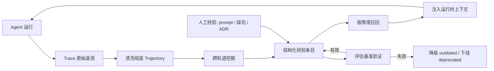
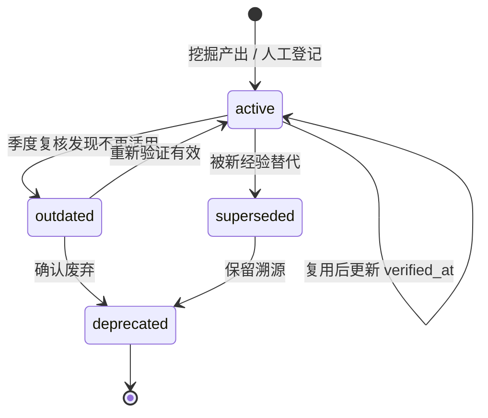

# Agent 经验自动积累与沉淀：工程方法论

> 本文随 skill 一起放在 `~/.agents/skills/experience-keeper/docs/`，是本设计的输入材料，
> 字段与流程的逐条映射见同目录 `2026-09-22-agent-experience-sedimentation-design.md` 的「方法论来源」。

来源：
- 阿里云《让 Agent 越用越准、成本越来越低：AgentLoop 的 Agent 经验自进化闭环》 https://developer.aliyun.com/article/1748448
- 腾讯云《每天用AI干活的技术人，该如何沉淀可复用的工程落地经验？》 https://cloud.tencent.com/developer/article/2727327

## 1. 两篇文章的分工

| 维度 | 阿里云 AgentLoop | 腾讯云 实战篇 |
| --- | --- | --- |
| 视角 | 平台级系统闭环 | 个人与团队的工程习惯 |
| 经验来源 | Agent 真实运行 Trace 自动挖掘 | 人工记录：prompt、踩坑、决策、评估 |
| 结构化载体 | 标准化 Trajectory + 结构化经验条目 | Prompt Registry、Incident KB、ADR、评估基准 |
| 生效方式 | Recall Skill + CLI 在运行时召回并注入上下文 | 存入知识库、检索复用、固化为 SOP |
| 关键量化 | 清洗后 Trajectory 降到原始 Trace 的 4%—6% | 反复使用 3 次以上才升级为团队标准 |
| 主要短板 | 依赖 Trace 接入完整度 | 依赖人的自觉，容易停更 |

腾讯篇回答"经验从哪来、怎么结构化"，阿里篇回答"如何自动挖掘、何时注入、怎么证明有效"。二者拼成完整链路。

## 2. 经验飞轮总览



两类来源汇入同一经验库：机器从轨迹挖出的行动经验，人从实践中写下的规则与决策。

## 3. 数据层：Trace 到 Trajectory

原始 Trace 含大量基础设施 Span、重复消息、与决策无关的数据，直接存储和分析会淹没有效信号。清洗目标是把"日志"变成"决策序列"。

`Trajectory` 是数据模型概念（标准化后的执行轨迹），指 AgentLoop 从原始 Trace 清洗组装出的结构，不是某个开源项目；原文没有引用任何仓库。名字与开源库 `letta-ai/trajectory` 撞车，两者是不同来源、不同产物。

| 保留 | 丢弃 |
| --- | --- |
| 任务目标、行动步骤、工具调用与参数 | 基础设施 Span、健康检查、心跳 |
| 观察结果、错误信息、恢复过程 | 重复消息、重试噪声帧 |
| 最终结果、完成判定动作 | 与 Agent 决策无关的中间日志 |
| 成本：Token、工具调用数、耗时 | |

Trajectory 数据模型：

```json
{
  "traj_id": "t_20260817_0001",
  "task_goal": "排查 ECS SSH 连接超时",
  "task_family": "ops.ecs.network",
  "outcome": "success",
  "steps": [
    {"idx": 1, "thought": "...", "tool": "cms_query", "args": {"metric": "cpu"}, "obs": "...", "error": null},
    {"idx": 2, "thought": "...", "tool": "ecs_describe", "args": {}, "obs": "...", "error": "Throttling"}
  ],
  "recoveries": [{"after_step": 2, "strategy": "退避后重试并降低批量"}],
  "completion_check": "重新查询确认指标恢复正常",
  "cost": {"prompt_tokens": 0, "completion_tokens": 0, "tool_calls": 0, "latency_ms": 0}
}
```

`task_family` 是挖掘的分组键，决定了后续哪些轨迹可以互相比较。

## 4. 经验层：结构化条目

经验不是轨迹摘要，也不是成功案例存档。它必须能回答"在什么条件下，做什么有效、做什么容易失败"。

| 字段 | 说明 |
| --- | --- |
| `exp_id` / `type` | 类型：工具选择与调用顺序 / 参数规则与前置条件 / 反模式 / 恢复策略 / 结果验证与完成判定 |
| `precondition` | 召回硬过滤条件：任务目标、业务对象、工具集、执行进度、错误状态、数据范围 |
| `action` | 可执行的行动规则，供 Agent 直接采纳 |
| `evidence` | 支撑该条目的 `traj_id` 列表与成功、失败计数 |
| `confidence` | 支持数 /（支持数 + 反例数），并附最小支持度门槛 |
| `cost_delta` | 注入前后 Token、工具调用次数、耗时的变化 |
| `scope` | 生效范围：AgentSpace、经验库、团队或项目权限边界 |
| `status` / `verified_at` | active / outdated / deprecated / superseded，加最后一次验证时间 |

条目示例：

```json
{
  "exp_id": "exp_7f3a",
  "type": "recovery",
  "precondition": {"tool": "cms_query", "error": "Throttling", "scene": "ops.metric"},
  "action": "指数退避重试，单次查询时间窗口收窄到 5 分钟，禁止原参数立即重试",
  "evidence": {"traj_ids": ["t_0001", "t_0017", "t_0042"], "success": 3, "fail": 0},
  "confidence": 1.0,
  "scope": "agentspace.al-playground",
  "status": "active",
  "verified_at": "2026-08-17"
}
```

## 5. 挖掘层：从多条轨迹提炼规则

单条轨迹只能做摘要，经验必须来自跨轨迹比较。

| 经验类型 | 挖掘信号 |
| --- | --- |
| 工具选择与调用顺序 | 成功轨迹中高频出现的 action 序列（序列模式挖掘） |
| 参数规则与前置条件 | 同一工具的参数分布在成功样本中的约束：取值范围、枚举、必需的前置调用 |
| 反模式 | 失败轨迹常见、成功轨迹稀有的动作或参数组合 |
| 恢复策略 | 「错误 → 后续动作 → 成功」三元组的统计频次 |
| 完成判定 | 成功轨迹末尾的验证动作：重新查询、断言、对照业务目标 |

伪代码：

```
for family in cluster(trajectories, key=task_family):
    S = [t for t in family if t.outcome == "success"]
    F = [t for t in family if t.outcome == "fail"]

    # 有效路径
    for seq in frequent_subsequences(S, min_support=3):
        if support_in(F, seq) < 0.3 * support_in(S, seq):
            emit(type="path", action=seq, evidence=seq.traj_ids)

    # 反模式
    for act in frequent_subsequences(F, min_support=3):
        if support_in(S, act) < 0.3 * support_in(F, act):
            emit(type="antipattern", action=act, evidence=act.traj_ids)

    # 恢复策略
    for err in errors(F):
        for follow in next_actions_after(F, err):
            rate = success_rate_of(follow, S)
            if rate >= 0.7:
                emit(type="recovery", action=follow, confidence=rate)
```

评价门槛：同一经验在真实任务中被反复验证 3 次以上，才够格进入团队级经验库；低于 3 次留在个人笔记，避免污染信噪比。

## 6. 召回层：在正确的时刻给少量经验

召回发生在四个决策节点，对应四类典型失败：选错入口、误用工具参数、空结果后盲目重试、未验证就交付。

| 时机 | 注入内容 |
| --- | --- |
| 任务开始 | 经过验证的入口选择与行动顺序 |
| 调用关键工具前 | 参数约束、数据范围、前置条件 |
| 出现错误或空结果后 | 有效的恢复方法 |
| 准备交付时 | 结果验证与完成判定规则 |

排序不能只靠文本相似度，需结合情境过滤与打分：

```
score = w1 * 情境匹配度        # 目标、工具、进度、错误状态与 precondition 的吻合度
      + w2 * confidence        # 证据支持度
      + w3 * 时效衰减(verified_at)
      + w4 * cost_delta        # 历史成本收益
      - w5 * 越界惩罚          # 超出 scope 或适用范围
```

硬过滤先行：`precondition` 不匹配直接排除，再排序取 top-k。目标是返回少量能改变行动的条目，而非更多历史内容。

CLI 形态（阿里云控制台自动生成命令与 Endpoint，无需手工拼 URL）：

```bash
node .skills/alibabacloud-agentloop-experience/scripts/search_context.js search \
  --query "排查 ECS SSH 连接超时的历史经验" \
  --context-type experience \
  --confirm-outbound
```

接入要点：查询文本包含产品名、错误信息、接口名或 Request ID；返回 JSON 且 `error` 为 `null` 即链路连通，`results` 为空只代表暂无匹配。凭证放环境变量或项目级 `.agentloop/recall.env`，项目配置加入 `.gitignore`，不写入查询命令、不提交 Git。

## 7. 生命周期管理

经验会过时。没有维护机制，知识库会变成"信息很全但大部分失效"的历史博物馆，反而降低检索效率。



维护动作：每季度复核一次，仍有效的刷新 `verified_at`，过时的标 `outdated`，被替代的标 `superseded` 并保留溯源链。经验出问题时可以快速限制作用范围、替换或下线，无需重训模型。

## 8. 度量体系

不看单次运行是否成功，看分布与下限。

| 指标 | 定义 | 用途 |
| --- | --- | --- |
| 平均任务成功率 | 任务族内成功占比 | 总体是否达标 |
| 首次完成率 | 无重试、无返工即完成 | 路径是否已收敛 |
| 质量下限与波动 | 同类任务多次执行的最低值与方差 | 能否稳定上线 |
| 失败模式集中度 | top-N 失败模式占比 | 优化空间定位 |
| Token / 成功任务 | 每完成一个成功任务的综合成本 | 最有意义的成本指标 |
| 工具调用次数、平均耗时、超时率 | | 无效探索的量化 |
| 人工接管率、返工率 | | 人工投入趋势 |

注入口径的实测数据（阿里云）：

| Bench | 注入前 | 注入后 | Token 变化 |
| --- | ---: | ---: | ---: |
| StarOps 指标查询 | 正确率 7.1% | 正确率 36.1% | -6.8% |
| OpenClaw / PawBench | 通过率 24.53% | 通过率 30.67% | -58.16% |
| PinchBench | 0.2928 | 0.3464（+18.3%） | +2.9% |
| ClawProBench | 74.51% | 78.43%（+3.92pp） | -11% |
| SWE-bench Verified | 67.2% | 74.4%（+7.2pp） | 362.4M → 536M |

StarOps 实验中平均工具调用次数下降 25.1%，有害事件下降 27.8%。PinchBench 与 SWE-bench 表明质量与成本存在权衡：目标是在质量护栏下优化单位成功成本，而非单独追求最低 Token。

## 9. 人工侧：四类经验的载体与实现

上表之外，人的经验同样需要工程化管理。

| 经验类型 | 载体 | 结构化要点 | 实现要点 |
| --- | --- | --- | --- |
| Prompt 经验 | Prompt Registry | 名称、模板、场景、模型、版本、效果评分、备注、tags | 模板内容哈希生成 ID，同名新内容自动把旧版标 `superseded_by`，同时落独立 md 文件便于 git diff |
| 踩坑经验 | Incident KB | 表象 symptoms、根因 root_cause、方案 solution、方案代码、环境、tags、关联记录、verified_at、status | 固定字段模板 + 多维度检索（类别、严重度、标签、关键词）；同根因记录互相 link |
| 方案决策 | ADR | 状态、背景、决策、方案对比、理由、影响、验证、参与者、关联文档 | 一决策一文件，文件名含日期；状态流转 proposed → accepted → superseded |
| 评估经验 | 评估基准 | 黄金测试集、通过率、平均与 P99 延迟、历史结果快照 | 每次模型升级、prompt 调整、RAG 优化后跑同一套基准，通过对比历史判断涨跌 |

检索设计决定可用性。"vLLM报错处理"这类标题三个月后搜"vLLM OOM"搜不到，所以必须把报错信息、根因、方案全文纳入检索字段，而不是只搜标题。

## 10. 落地路线

| 阶段 | 动作 | 产出 |
| --- | --- | --- |
| 1 | 建 Prompt Registry，把有效 prompt 当代码管 | 团队 prompt 库 |
| 2 | 建 Incident KB，结构化记录每次非平凡踩坑 | 排障知识库 |
| 3 | 用 ADR 记录技术选型的"为什么选 A 不选 B" | 决策库 |
| 4 | 固定黄金测试集与量化指标 | 可对比的评估基准 |
| 5 | Agent Trace 接入（探针、OpenTelemetry、Pilot、eBPF 任一） | 原始遥测数据 |
| 6 | 清洗组装 Trajectory，开自动挖掘 | 数据底座与经验条目 |
| 7 | 装 Recall Skill，配置经验库与凭证 | 运行时召回闭环 |
| 8 | 把验证过的经验固化为 SOP，嵌入工具链 | 无感消费 |

三条实操原则：

1. SOP 从项目里跑出来，不在会议室里编。每个项目收尾问三件事：哪些做法固化为标准、哪些坑进检查清单、哪些决策值得记 ADR。
2. 能自动化的不靠人记。prompt 标准库接入工具链、部署检查清单做 CI 校验脚本、故障手册接入告警系统。
3. 清理比新增更重要。保持信噪比比堆条目数更有价值。

无感消费的两个例子：开发提交 PR 时审查工具自动加载团队标准 prompt；值班收到告警时诊断报告自动关联历史相似案例。

## 11. 与既有能力的边界

| 能力 | 解决的问题 | 生效方式 |
| --- | --- | --- |
| Memory | 这个用户、会话或 Agent 过去发生过什么 | 检索用户事实、偏好、历史事件 |
| RAG / 知识库 | 规则、文档和业务事实在哪里 | 从外部知识源检索补充事实 |
| Workflow / SOP | 标准流程应该怎样执行 | 人工定义的步骤与规则编排 |
| Prompt Engineering | 如何约束模型的通用行为 | 修改系统提示词或任务模板 |
| Skill | Agent 具备什么可复用能力 | 封装操作方法、脚本、工具与资源 |
| Fine-tuning / SFT | 如何改变模型的整体行为倾向 | 用训练数据更新模型权重 |
| RL | 如何通过奖励优化模型策略 | 基于轨迹与奖励训练策略 |
| 经验自进化 | 当前情境下过去哪些行动有效、哪些容易失败 | 从轨迹挖掘经验，运行时检索并注入上下文 |

协同关系：RAG 给业务事实，Memory 给用户与会话背景，Skill 给可执行能力，经验库给行动经验，评估与实验证明变化是否真的提高了质量。

经验库位于模型之外，因此可服务不同模型与 Agent 框架、可按任务动态召回、可快速更新而不重训、可按团队与权限控制作用范围、可与评估结果结合持续验证是否仍然有效。

一句话总结：观测系统负责看到真实运行，评估系统负责定义什么是好，经验自进化负责把已经验证的有效方法重新带回运行。
