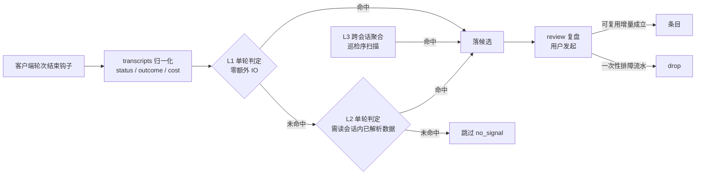

# 经验预筛表设计

**这是经验采集的核心设计。** 「哪一轮值得落候选、落候选时记什么」全部由本文定义，
其他地方只允许出现指针，不得复述判定条件。

| 项 | 内容 |
| --- | --- |
| 权威范围 | 信号清单与触发条件、可复用闸门、判定准则、域触发点、误报控制、实现进度 |
| 执行定义 | `scripts/prescreen.py`（`detect_signals`、`detect_correction`、`classify_reuse`、`classify_turn_asset`） |
| 写入契约 | `schema/candidate-v1.schema.json`（`signal` 与 `reuse` 枚举） |
| 资产登记表 | `~/.agents/experience/assets/<项目>/registry.jsonl`，索引而非主存，可重建 |
| 一致性锁 | `tests/test_experience.py` 的 `PrescreenTableTest` 与 `SchemaTest` |
| 复盘动作 | `SKILL.md`「复盘一条候选的标准动作」第 2 步与「四个时机检索经验」 |
| 上游背景 | `2026-09-22-agent-experience-sedimentation-design.md`（采集与复盘的总体设计，信号部分已收归本文） |

## 为什么逐轮预筛

会话转录逐轮落盘，不做预筛等于把全部对话写成候选：复盘成本随会话长度线性上升，
真正值钱的经验被流水淹没。预筛只做一件事——**判断这一轮是否值得占用一次复盘成本**，
不做判断对错、不写条目、不调模型。

## 判定准则：什么才值得提炼

触发经验提炼的从来不是「过程发生了什么」，而是**哪一刻产生了无法从文档与源码恢复的信息**。
文档能查到的、源码能读到的、`--help` 能打印的，都不值得落库。按这条筛完只剩四类：

| 信息类别 | 恢复方式与成本 | 是否可程序化判定 |
| --- | --- | --- |
| 实测数值与阈值 | 必须复现环境重测，随版本与局点漂移 | 部分：数值抽取 |
| 现象与原因的映射 | 必须重走一遍推理 | 难：措辞自由，需语义判定 |
| 内部约定与坑 | 没人踩过就得再踩一次 | 极难：只能靠用户明示或追问 |
| 可运行的资产 | 重写一遍即可，成本中 | 容易：路径与内容判定 |

阶段性方案取舍、评审意见、纠正和源码引用本身都不属于这四类。凡不落在四类里的轮次，
即使命中过程类信号也不得生成候选。

### 候选准入闸门

信号只描述本轮发生了什么，不代表结论可复用。`experience_hook` 写候选前必须按顺序过准入闸门，命中即停：

| 顺序 | 判定 | 处理 |
| --- | --- | --- |
| 1 | 本轮把结论写入已识别载体。载体范围：`AGENTS.md`/`SKILL.md`/`README.md`/`CLAUDE.md`/`CONTRIBUTING.md`、工作区 `.harness/**`（规则、知识库 `kb/`、调研 `research/`、评测 `evals/`、模板 `templates/`、迭代 `iterations/`、本地工作区 `.local/`）、子仓 `.ai/**` 与 `.ai-knowledge/**`、`openspec/**`，以及仓库内 `docs/`、`doc/`、`kb/`、`research/`、`evals/`、`templates/`、`iterations/` 文档目录。委托类工具（`Agent`/`Task`/`SendMessage`）的参数点名载体路径同样算——写盘发生在子会话里，父轮只剩一条委托调用；但泛化的文档目录名录只对真写盘工具生效，委托 prompt 里点到 `docs/` 路径是「让对方去读」，不是本轮写进载体 | 跳过候选；载体已经保存结论 |
| 2 | 用户明确提出长期约束，且本轮纠正与「以后/今后/始终/记住」等持久意图同时出现 | 允许候选 |
| 3 | 本轮全程只读源码与文档（讨论轮，见下） | 跳过候选；结论由 OpenSpec 等项目载体保存 |
| 4 | 命中 `asset_script` | 允许候选，用于登记可复用脚本位置，即使本轮同时更新载体 |
| 5 | 命中实测、根因映射、协议边缘、状态异常或可复用资产等证据型信号 | 允许候选 |
| 6 | 其余：只有错误后恢复、重试、方案被否决、阶段性取舍、普通纠正、行号引用、幂等抖动或工具数量等过程信号 | 跳过候选 |

`grounded_verdict` 只说明结论引用了源码位置，不能证明结论超出当前变更范围，也不能单独准入。
`cost_decision`、`review_rejected`、`decision_reversed`、普通 `user_correction` 与
`idempotency_mismatch` 同样只作复盘线索：幂等判据本身成立，但 31 次判决只转正 4 条（13%），
绝大多数命中是「同一命令跑两次结果不同」的过程现象，`push 各仓改动` 这类纯操作轮也会命中。
当前任务的设计结论由 OpenSpec 等项目载体保存，不进入经验候选；只有明确的长期约束可单独保留。

### 讨论轮闸门

方案设计、评审与设计问答轮没有实测数值、没有错误原文、没有状态异常：判据只能从讨论文本里取词，
而讨论文本是转述。实测过的一批 8 条候选全部出自这类轮次（`Agent` 的 prompt 正文里「不能引入快照方案」
落 `blast_radius_guard`、「删除三个对象 + 统计口径」落 `cost_trap`）。

判定按「本轮是否触达现场」走，**只有全程都是读源码/读文档才拦**——方向是宁可判成执行轮：

| 调用形态 | 是否触达现场 | 判据 |
| --- | --- | --- |
| 叙述承载类工具 `Agent`/`Task`/`SendMessage`/`AskUserQuestion`/`TodoWrite` | 否 | 工具名在 `NARRATIVE_TOOLS` 里 |
| 写盘类工具 `write`/`edit`/`apply_patch`/`file_change` | 是 | 只要写盘就不是讨论轮 |
| 只读检索与只读 git 子命令（`rg`/`grep`/`findstr`/`Select-String`/`Get-Content`/`Test-Path`/`git show`…） | 否 | `READONLY_CMD_RE` / `READONLY_GIT_RE` |
| agent 工具链自身入口（`skills/*/scripts/`、`.harness/scripts/`、`experience.py`/`workspace.py`） | 否 | `AGENT_TOOLING_RE` |
| 参数里的路径落在内核、日志、抓包面（`/proc/`、`/sys/`、`/var/log`、`.log`、`.pcap`） | 是 | `FIELD_PATH_RE`，优先于只读检索判定 |
| 外部 CLI（`aliyun`/`kubectl`/`conntrack`/`ethtool`/`tcpdump`/`perf`/`make`…） | 是 | `EXTERNAL_CLI_RE`，优先于只读检索判定 |
| 参数为空、或认不出的调用 | 是 | 兜底判为执行轮 |

没有工具调用的纯聊天轮不算讨论轮：纠正与长期约束仍要能落候选。
判据在 `prescreen.is_discussion_only()`，跳过原因写作 `discussion_only`。

## 可复用资产的跨会话存续

### 问题

候选生命周期短（可被 `drop`、`gc --older-than 90d` 清掉），会话结束即换上下文。
于是出现这个断层：**脚本落在盘上，指向它的候选没了，新会话里没人知道它存在**。
只靠候选撑不起资产连续性，asset 必须在经验库里独立建档。

### 三层职责

Git 索引已跟踪的文件由仓库维护，不登记为经验库可复用资产。采集、登记与刷新查询均排除这些文件；
按文件所在的最近 Git 仓库判定，覆盖独立子仓和 worktree。未跟踪文件仍须通过可复用闸门。

| 层 | 载体 | 生命周期 | 解决的问题 |
| --- | --- | --- | --- |
| 物理资产 | 仓库或 skill 目录里的脚本、模板、文档 | 长期，随代码库走 | 资产本体不丢 |
| 指针 | 候选记录（`asset_script` 信号 + `reuse: reusable`） | 短期，可被清理 | 说明资产是什么、哪一轮产出 |
| 索引 | 资产登记表 `assets/<项目>/registry.jsonl` | 中期，可重建 | 跨会话知道资产存在、在哪、何时该用 |

**登记表是索引不是主存**：一条记录由候选里的路径指针 + 文件系统 stat 重算得到，
删掉整份 `registry.jsonl` 用 `experience.py assets` 即可重建，不存在只此一份的数据。

### 登记表记录

一行一版本，`path` 是会话之间的稳定身份：

| 字段 | 含义 |
| --- | --- |
| `asset_id` | 稳定短标识（路径哈希），同一文件改写后仍是同一 id，供人引用 |
| `path` | 绝对路径，跨会话的身份锚点 |
| `hash` | sha256 前 16 位，用于识别改写与漂移 |
| `size` | 字节数，配合 `hash` 判断是否是同一份 |
| `reuse` | `reusable`，或待确认 |
| `first_seen` / `last_seen` | 首次与最近产出时间，`last_seen` 决定是否陈旧 |
| `uses` | 跨会话被再次产出的次数（同一 `path` 出现在新的 `asset_script` 候选即 +1） |
| `produced_by` | 项目、会话、候选 id，回溯到证据链 |
| `status` | `active` / `stale` / `gone` / `archived` |

### 四个生命周期动作

| 动作 | 触发 | 处理 |
| --- | --- | --- |
| 登记 | 钩子落 `asset_script` 候选且 `reuse: reusable` | 幂等追加一行，同 `path` 更新 `last_seen` 与 `uses`；写失败只记诊断，不影响候选落盘 |
| 重建 | `experience.py assets` | 遍历全部候选的路径指针，stat 磁盘文件；表丢失或跨机器复制后可重算 |
| 陈旧与删除 | 同一条命令 | 30 天未被再次产出 → `stale`；文件已不存在 → `gone`（保留记录做曾产出的证据） |
| 漂移 | 同一条命令 | 严格指纹变了但逻辑指纹一致 → 只更新指纹，不改状态；两者都变 → `drift_detected` + `modified_out_of_band` |
| 归档 | 已转成条目 | `archived`，后续检索由条目承担 |

### 会话外改动：严格指纹与逻辑指纹

开发者在 IDE 或 vim 里改脚本不经过会话，落盘内容一变严格哈希就不同。只用严格哈希判同一性，
「补一行注释」会被当成新资产，`uses` 计数断链，跨会话复用证据永远攒不够。

| 指纹 | 算法 | 用途 |
| --- | --- | --- |
| `hash` | 全文件 sha256 前 16 位 | 检测内容变化 |
| `logic_hash` | 剥掉块注释、行注释、docstring、全部空白后 sha256 前 16 位 | 判断变化是否只影响格式或说明 |

判定矩阵：

| `hash` | `logic_hash` | 状态 | `uses` |
| --- | --- | --- | --- |
| 相同 | 相同 | 不变 | 累加 |
| 变化 | 相同 | 不变（格式或注释改动） | 累加 |
| 变化 | 变化 | `drift_detected` + `modified_out_of_band: true` | 不累加也不重置 |

`drift_detected` 是提示不是隔离：资产仍参与检索，复盘时能看到「它被会话外改过」，
据此判断是否要重新核实条目内容。

### 候选 30 天淘汰与转正门禁

候选最长存活 **30 天**（`lib.CANDIDATE_MAX_AGE_DAYS`），与资产陈旧口径同值，避免「候选没了、
资产还在飘」的时间错位。超期未转正即淘汰，但有两条例外：

| 情况 | 处理 | 理由 |
| --- | --- | --- |
| 候选带 `asset_script` 信号，且登记表里有对应 `reusable` 资产 | **不淘汰**，`gc` 列表里单列「先转正或明确丢弃」 | 候选是路径指针：静默淘汰会把「盘上有可用脚本」这件事一起清掉，回到最初那个断层 |
| 用户明确加 `--force` | 连同这类候选一起淘汰 | 指针没了，登记表记录仍在，资产不会失联 |

`gc` 是预演优先：不带 `--apply` 只打印将要淘汰的条数与被拦下的候选 id，看清了再执行。

### 域差异化 TTL

底层与性能类经验的复现周期以月计（网卡队列在百万并发下的中断绑定、连接跟踪容量耗尽），
按应用层脚本的 30 天口径会把它们清在复现之前。命中下列信号的候选按季度复核：

| 信号 | TTL | 理由 |
| --- | --- | --- |
| `nonfunctional_floor` | 90 天 | 内核与转发面参数要等特定负载才复现 |
| `soft_limit` | 90 天 | 容量经验值来自压测，重跑一次压测成本高 |
| `no_convergence` | 90 天 | 收敛行为与版本、局点相关，复现窗口长 |
| `cost_trap` | 90 天 | 本环境专属数值，换机器就得重测 |
| 其余全部信号 | 30 天 | 应用层经验，一个月不复现即无价值 |

`gc --older-than <N>d` 显式指定时覆盖域口径，按统一 N 天执行。

E1 `intent_repeat` 的 7 天窗口不受影响：它统计的是窗口内候选的工具族，
而底层候选本身能活 90 天，两者不冲突——窗口决定「多久算重复」，TTL 决定「证据留多久」。

### uses ≥ 2 即升级判据

`uses` 是唯一不需要人工判断的复用证据：同一个 `path` 在**不同会话**被再次写出，
说明「重写一遍脚本」这件事真的在重复发生，此时资产该转成条目或 `kind: reference` 条目，
把「下次去哪个路径拿」也写清楚。

### 跨会话寻回

| 入口 | 行为 |
| --- | --- |
| 开场提示 | `prompt` 追加未确认资产计数：`经验库：3 条待复盘候选，另有 2 个未确认的可复用资产` |
| 检索 | `search` 结果末尾单独列出 `reusable` 且 `status=active` 的资产：`asset_id`、路径、`last_seen`、`uses` |
| 维护 | `assets` 列表 + `doctor` 体检 |

登记表**不进钩子热路径**：钩子只做一次幂等追加，重建、陈旧标记、删除检测都在 CLI 侧。

**升级规则同样只对新增内容生效**：候选记录在落盘那一刻定型，之后新增的信号、字段都不会回头判定历史候选。
两条 L3 信号（`intent_repeat`、`artifact_churn`）是刻意的例外——它们只读候选里已有的工具族与路径，
所以 `sweep` 能把新判据补到旧候选上。

## 触发点与分层



三层是刻意的：L1/L2 在钩子里逐轮跑，绝大多数信号必须落在这两层，否则采集会拖慢客户端轮次结束；
L3 需要历史聚合，只能由 `experience.py` 的巡检序承担，不进钩子热路径。

| 层 | 运行位置 | 约束 |
| --- | --- | --- |
| L1 | 钩子进程，单轮零额外 IO | 新信号优先落这里 |
| L2 | 钩子进程，读本轮已解析的完整数据 | 可用工具序列、状态、返回值 |
| L3 | `experience.py` 巡检序 | 可跨会话聚合，不进热路径 |

## 信号总表

列含义：**判定输入**是该信号能读到的字段；**成本**是相对原六条判定新增的开销；
**对应触发点**指向下文三张工程域表。

### 族 A 错误与恢复

| 编号 | 信号 | 触发条件 | 判定输入 | 层 | 成本 | 对应触发点 |
| --- | --- | --- | --- | --- | --- | --- |
| A1 | `error_recovered` | **同一命令族**先 `error` 后 `ok`；CLI 用法错误与测试红绿降级，不计恢复 | `tools[].status` + 命令族（去 shell 包装后的首 token 与子命令） | L2 | 低 | S-1 |
| A2 | `retry` / `retry_loop` | `retry`：同一工具同一参数重复调用且至少一次不是 `ok`；`retry_loop`：同一命令族**连续**失败 ≥2 次 | `tools[]` 名、参数、状态、命令族 | L2 | 低 | S-1 |
| A3 | `dep_fix` | 依赖或环境安装类调用，且其后同类操作转 `ok` | 工具名与参数关键词（`pip`、`npm`、`apt`、`cargo`…） | L1 | 无 | S-2、S-3 |
| A4 | `fallback_switch` | 前一工具链失败后改用不同工具、接口或数据源并成功 | 轮内工具序列 + 上一轮 `outcome` | L2 | 无 | S-1、O-1 |

### 族 B 判决与推理

| 编号 | 信号 | 触发条件 | 判定输入 | 层 | 成本 | 对应触发点 |
| --- | --- | --- | --- | --- | --- | --- |
| B1 | `user_correction` | 命中下文「人类纠正的判定」任一方式（原信号） | 用户消息 + 相邻轮 | L1 | 无 | S-8 |
| B2 | `user_override` | 用户自己动手完成，或直接给出结论与参数（原信号） | 用户消息 + 工具状态 | L1 | 无 | S-8 |
| B3 | `decision_reversed` | 会话内后一轮推翻先前轮次的结论或方案 | 相邻轮 `assistant` 结论段 + 关键词 | L2 | 低 | O-6 |
| B4 | `review_rejected` | 代码、方案或变更评审被打回并附带理由 | 工具返回值或用户消息中的打回理由 | L1 | 低 | S-8 |
| B5 | `grounded_verdict` | 本轮结论出现 ≥3 处 `文件:行号` 引用（路径带扩展名） | `assistant` 全文 + 引用计数 | L1 | 无 | —；仅辅助复盘，不单独准入候选 |

B5 是复盘线索：结论锚定行号说明本轮可能做过源码比对，但方案评审和阶段性决策也会大量引用行号，
因此它不再作为候选准入依据。只有同时命中独立的可复用证据时才保留该标签。

### 族 C 资产生成

产出的东西只有满足**可复用**前提才算资产。存在性判据已被否决：脚本写完就用一次、
换环境就失效的产出不进候选池。

| 编号 | 信号 | 触发条件 | 判定输入 | 层 | 成本 | 对应触发点 |
| --- | --- | --- | --- | --- | --- | --- |
| C1 | `asset_script` | 本轮新建或改写 Git 未跟踪的可复用脚本或配置 | 写盘类工具路径后缀 + Git 跟踪排除 + 可复用闸门 | L1 | 低 | S-3、S-6、N-6、O-8 |
| C2 | `asset_recipe` | 单轮内 ≥3 条同类诊断命令成组出现 | 工具名 + 命令族正则 | L2 | 低 | N-3、N-5、O-2、O-4 |
| C3 | `asset_query` | 出现日志或指标查询语句，且带具体字段口径；**源码检索命令的检索模式不算**——`Select-String -Pattern 'dests\|stats'`、`rg "…stats\.h"` 是看代码 | 查询文本（索引名、字段、时间窗）；参数命中只读检索或 git 读取时不做匹配 | L2 | 低 | O-2、O-3 |
| C4 | `asset_diagram` | 本轮产出 Mermaid、拓扑或流量路径图 | 写盘内容块标记 | L1 | 低 | N-2 |

### 可复用闸门

任何「产出了资产」的判断都必须先过闸门。判定按优先级走，命中即停：

| 顺序 | 判据 | 结论 |
| --- | --- | --- |
| 1 | 带参数或环境变量入口（`argparse`、`add_argument`、`sys.argv`、`os.environ`、`getenv`） | `reusable` |
| 2 | 结构化配置模板（`.tf`、`.yaml`、`.yml`、`.j2`、`.tmpl`、`.conf`、`.ini`、`.json`） | `reusable` |
| 3 | 落在临时目录（`/tmp/`、`%TEMP%`、`AppData\Local\Temp`、`/dev/shm`） | `one_off` |
| 4 | 顶层赋值里写死现场值（IP、资源 ID、ARN、UUID、AccessKey）且无参数入口 | `one_off` |
| 5 | 以上都不命中 | `reusable` |

第 4 条只认赋值语境（行首 `键 = 值` 或 `键: 值`），出现在注释、示例、docstring 或函数体内的值不算一次性痕迹。
理由：注释里的 IP 是说明，赋值里的 IP 才是换环境必须先改源码。

**诊断配方例外**：抓包、看路由、查会话表这类命令天生带现场值
（`tcpdump -i eth0 host 10.0.0.1 -w /tmp/x.pcap`），命令的形状可复用而参数随现场变。
出现两个诊断命令族（或一个诊断族加一次探测）时绕过第 3、4 条，直接判 `reusable`——
否则网络排障最常用的配方全被当成一次性产出丢掉。

`reuse: one_off` 的候选保留在候选池里但不落 `asset_script` 信号，供复盘判断「结论值钱、脚本不值钱」——
结论提成判据型条目，脚本随候选一起 `drop`。

### 族 D 环境与前置条件

| 编号 | 信号 | 触发条件 | 判定输入 | 层 | 成本 | 对应触发点 |
| --- | --- | --- | --- | --- | --- | --- |
| D1 | `env_recovery` | 会话内复现环境、启动服务、挂载或联网初始化成功 | 命令族正则 + 其后 `ok` | L1 | 低 | S-3 |
| D2 | `prereq_discovered` | 首次打通某条访问路径，此前失败点在认证、网络、代理、证书、白名单或配额 | 失败轮 `error` 原文 + 关键词；`proxy`/`kms` 这类 ASCII 短词按词边界匹配，分支名 `gameproxy` 不算 | L2 | 中 | O-7 |
| D3 | `cost_trap` | 出现只在本机或本环境成立的耗时、阈值、坑点数据；数值须带量词或单位，年份与 ≥7 位数字不算 | 工具参数、错误原文与非文档结果中的数值与口径句 | L1 | 中 | N-5、N-10 |

### 族 E 跨轮聚合

| 编号 | 信号 | 触发条件 | 判定输入 | 层 | 成本 | 对应触发点 |
| --- | --- | --- | --- | --- | --- | --- |
| E1 | `intent_repeat` | 同一操作族在 7 天窗口内跨 ≥2 会话出现 ≥3 次 | 历史候选的工具族统计 | L3 | 已实现 | S-3、O-2 |
| E2 | `qa_reflex` | 用户在同一会话内就同一问题追问 ≥3 次 | 本条之前用户提问的相似度 ≥0.75 | L2 | 已实现 | S-8 |
| E3 | `artifact_churn` | 同一脚本或文件在多会话被反复改写，且未固化为载体 | 文件路径跨候选统计 | L3 | 已实现 | S-3 |
| E4 | `convergence_delay` | 同一资源标识经 ≥4 次尝试才达成目标状态 | 会话内同一标识的多轮工具调用 | L2 | 已实现 | N-10 |
| E5 | `no_convergence` | 变更已下发但状态读取仍为旧值或期望值未出现 | 状态读取返回值命中旧态词；旧值只从现场输出读——读源码、读文档、检索仓库的结果是转述，其中遍地是 `unchanged`、`pending` 这类状态词 | L1 | 已实现 | N-1 |
| E6 | `idempotency_mismatch` | 同一操作重复执行得到不同结果，且差异落在**稳定字段**上 | 同参两次调用的返回值，规范化后对比 | L1 | 已实现 | O-11 |

E6 只作复盘线索，不进证据型准入清单（见「候选准入闸门」第 6 行）：31 次判决转正 4 条，
单独命中时落候选的绝大多数是纯操作轮。

### 族 F 非功能、性能与成本

| 编号 | 信号 | 触发条件 | 判定输入 | 层 | 成本 | 对应触发点 |
| --- | --- | --- | --- | --- | --- | --- |
| F1 | `perf_limit` | 出现硬限制：平台或协议的天花板（端口耗尽、65535、连接跟踪上限），数值带单位或与硬限语境词同窗口 | 工具参数、错误原文与非文档结果中的硬限语境词 + 数值（中文量词计数不算容量，≥7 位数字算 ID 不算数值；硬限词须独立成词，源码标识符里的 `MAX_DESTS`/`limit` 不算语境） | L1 | 中 | N-7、S-5 |
| F2 | `soft_limit` | 出现软限制：本环境的经验值（超过 5 万条会 OOM、阈值、实测口径） | 同一窗口内的软限语境词 + 数值 | L1 | 中 | N-5、S-5 |
| F3 | `cost_decision` | 多方案取舍的判据是费用、配额、SLA 或合规，**且**同一窗口出现取舍结构与决定判词（采用/选择/决定） | 用户消息与结论段 | L1 | 中 | N-9 |
| F4 | `nonfunctional_floor` | 方案里出现连接跟踪容量、本地端口范围、TCP 缓冲区、文件句柄等参数调整 | 内核参数名正则 | L1 | 中 | N-5、N-6 |

硬限与软限分开的理由是复盘出口不同：**硬限转监控告警规则，软限转开发前置约束**。
两者混在一条信号里，复盘时无法分流。判据同一段文本命中两类语境时，硬限优先。

### 族 G 运维、变更与风险

| 编号 | 信号 | 触发条件 | 判定输入 | 层 | 成本 | 对应触发点 |
| --- | --- | --- | --- | --- | --- | --- |
| G1 | `batch_mutation` | 同一工具对不同资源标识连续执行 ≥3 次变更类操作 | 工具名 + 资源标识去重计数；变更动作词独立成词才算（`mutation_action()`：`address-delivery.md` 里的 add、`core_vpc_add()` 里的 add 不算，`DeleteRouteEntry` 这类 camelCase 动作名算） | L2 | 中 | O-9 |
| G2 | `blast_radius_guard` | 出现快照、备份、灰度、限速、dry-run 等先兜底动作后才动变更 | 工具参数关键词（叙述承载类工具的参数除外，见「判据取词面」） | L1 | 低 | O-8 |
| G3 | `evidence_capture` | 动变更前先导出证据（抓包、配置快照、日志导出） | 工具参数（叙述承载类工具的参数除外） | L1 | 低 | O-8 |
| G4 | `env_hazard` | **工具参数**里出现不可逆或高危动作（drop database、删库、mkfs、wipefs、iptables -F、ip route flush、sysctl -w…） | 工具参数关键词；环境名词（线上、生产环境、回滚、临时环境）不参与判定 | L1 | 低 | O-10 |
| G5 | `probe_discipline` | 连续 ≥3 次探测、采样或抓包以确认现象规律 | 工具族计数 | L2 | 低 | O-4 |

### 族 H 通用

| 编号 | 信号 | 触发条件 | 判定输入 | 层 | 成本 | 对应触发点 |
| --- | --- | --- | --- | --- | --- | --- |
| H1 | `multi_source` | 调用 ≥2 个别的 skill 的资产（`skills/<名>/scripts/`），或工具种类 ≥4 | 工具参数路径 + 工具名集合；读 `SKILL.md` 与 experience-keeper 自身入口不计 | L1 | 无 | O-2 |

H2 `slow` 已移除：单轮墙钟与轮次价值无因果（8 条候选里 5 条带它，零沉淀价值），
时长仍写进候选 `cost.duration_ms`，不再产生信号。信号名保留在 schema 枚举里，供存量候选校验。
| H3 | `failure` | `outcome` 为 `aborted` 或 `incomplete`（原信号） | `outcome` | L1 | 无 | — |
| H4 | `agent_note` | 采集侧不产出。agent 自记备选时由 `experience.py note` 写入 | 无（人为入口） | — | — | — |

### 族 I 深水区经验

四类隐性知识流失后排障成本最高，判据刻意收窄，落候选一律标 `confidence: pending`。

| 编号 | 信号 | 触发条件 | 判定输入 | 层 | 成本 | 对应触发点 |
| --- | --- | --- | --- | --- | --- | --- |
| I1 | `offload_matrix` | 卸载特性（GRO/LRO/TSO/checksum…）出现在底座语境中：出现 `ethtool -k`，或校验和/巨帧/包长异常，或机型、驱动、固件、内核版本被交代 | 特性词 + 底座语境 + 异常标记 | L1 | 中 | N-12、N-6 |
| I2 | `diagnostic_hazard` | 高强度观测（tcpdump、pdump、strace、perf、bpftrace…）与高负载语境（cps/qps/百万/现网）**与**退化症状（CPU 打满、时延激增、吞吐断崖、服务重启）三者同时出现；或抓包命令本身没有包数/时长上限 | 观测命令 + 负载语境 + 症状词 | L1 | 中 | O-13、O-4 |
| I3 | `protocol_edge` | 协议边缘特征（分片、PMTU 黑洞、非对称路由、RST、conntrack 建不起来、乱序、NAT64）**且**变更类调用的参数里出现配置调整（sysctl、ip route、iptables、MTU/MSS…） | 现象词取工具错误原文与非文档结果；闭环词只取变更类调用参数（只读检索不算） | L1 | 中 | N-13、N-4 |
| I4 | `state_machine_stuck` | 同一资源被状态读取 CLI 轮询 ≥3 次仍不变，或出现状态冲突，且最终靠改顺序、加等待走通 | 轮询须命中状态读取 CLI（aliyun/kubectl/systemctl…）+ 标识计数；冲突词 + 解决动作 | L2 | 中 | N-14、N-10 |

### 判据取词面：现场证据 vs 转述

判据型信号的价值来自「本轮实测到什么」，因此取词面按来源分层，越界即误报：

| 来源 | 是否参与判据取词 | 理由 |
| --- | --- | --- |
| 工具参数（命令、路径、写盘内容） | 是 | 动作的现场 |
| 叙述承载类工具的参数（`Agent`/`Task`/`SendMessage`/`AskUserQuestion` 的 prompt、message、question） | **否** | 参数就是 agent 写的正文：方案里提到「快照」「三个」「统计口径」会配成 `blast_radius_guard` 与 `cost_trap` |
| 工具错误原文 | 是 | 现象最可靠的召回键 |
| 非文档类工具结果 | 是（截断 1200 字符） | 命令输出的现场：实测数值、状态旧值、抓包统计。读 `/proc`、日志、抓包文件算现场；检索仓库的结果是转述，按下面的规则排除 |
| 读取 `.md`/`.txt`/`.rst` 的结果 | **否** | 文档是转述，总结里的「提升 50%」「压测」「配额」不是本轮实测 |
| 结果本身是文档正文（≥2 个 Markdown 标题行） | **否** | 经 `rg` 或 skill 抓回来的文档内容同样是转述，参数里看不到 `.md` 也要挡住 |
| 用户消息与 assistant 叙述 | **否**（`cost_decision` 除外） | 叙述里的现象词与动作词会互相配成假闭环 |

工具结果的排除规则（`prescreen._judgement_result`），按顺序判定，命中即排除：

| 顺序 | 判据 | 理由 |
| --- | --- | --- |
| 1 | 参数命中 `DOC_READ_RE`（`.md`/`.txt`/`.rst`…），或结果本身是文档正文（≥2 个 Markdown 标题行） | 读文档拿到的是转述 |
| 2 | 参数里的路径**全部**是源码或文档后缀（`_reads_source_file`） | 读源码拿到的是代码，不是本轮实测 |
| 3 | 参数命中仓库检索命令（`rg`/`grep`/`findstr`/`Select-String`/`find`）或只读 git 子命令 | 检索仓库的输出是代码与历史的转述 |
| 4 | 参数里的 here-doc / here-string 正文（`cat > x <<'EOF' … EOF`、PowerShell `@'…'@`） | 参数里塞一整段脚本时，正文是脚本内容：里面的「回滚」「一次本机」不是本轮的兜底动作与实测数值。`_command_text()` 去掉正文，只留命令行 |
| 5 | 以上都不命中 | 视为现场输出：`cat /proc/...`、`Get-Content *.log`、`dmesg`、`conntrack -S`、`tcpdump`、`curl`、控制面 CLI 的返回值都算 |

第 3 条刻意不含 `cat`/`head`/`tail`/`Get-Content`：它们读的可能是内核面与日志面，那是现场；
按路径判而不是按命令名一刀切，第 2 条先一步挡掉读源码文件的情况。
第 4 条只去正文、留命令行：`cat > openspec/…/x.md <<'EOF'` 的落点仍在命令行上，载体判定照旧有效。

对照组（同一批样本 8 个轮次复跑）：误报全部来自「转述」一栏——总结文档里的「线上」落 `env_hazard`、
文档正文里的「压测/限速」落 `perf_limit`、`rg -n "mtu"` 的检索模式落 `protocol_edge` 的闭环词。
`cost_decision` 是例外：决策取舍的现场就是人的决策语句，因此取用户消息与结论段，
但必须同时出现取舍结构与决定判词。

四条判据的共同取舍：**现象必须配闭环**。I2 要三个条件同时成立（只抓包不算，只说慢不算），
I3 要求本轮真落到配置调整上（只抱怨「怀疑是分片」不算），I4 要求真走通（一直 pending 不算）。
理由：深水区现象的抱怨量大、结论少，不配闭环会把候选池灌满未验证的猜测。

I1 的条目形态固定为「版本/硬件矩阵 + 规避参数」，I2 固定为「禁忌动作 + 安全替换」，
I3 固定为「现象 → 抓包特征 → 修复配置」，I4 固定为「隐藏依赖关系与状态流转」——
四类经验的价值在结构，不在单条结论。

## 人类纠正的判定

人类纠正是价值最高的一类信号：它直接给出 agent 认知或行为的一个候选正确版本，信息量远大于
agent 自己的成功路径。但用户未必正确，纠正只是待核实的假设，入库前必须核实（规则见「候选到条目的收敛」）。
判定不能只靠关键词，按下列六种方式并行识别：

| 判定方式 | 识别依据 | 归属信号 |
| --- | --- | --- |
| 显式否定 | 用户消息含否定或纠错表达（不对、不是、错了、搞错、重来、我说的是、我不是说、你理解错、不需要、不用、不要、不应该） | `user_correction` |
| 需求重述 | 相邻轮用户重复同一诉求且措辞变化，或两句字符二元组相似度 ≥0.6 | `user_correction` |
| 方案否决 | 用户否定 agent 提出的方案、计划或结论（不行、不好、换个、换一种、重新、还是用、改成、别用、不要用、没必要） | `user_correction` |
| 权限拒绝 | 用户拒绝 agent 发起的工具调用请求（`tools[].status == denied`） | `user_correction` |
| 直接给答案 | 用户给出正确结论、命令、路径或参数，取代 agent 的方案（应含具体值） | `user_override` |
| 手工接管 | 用户展示了自己修改后的文件或输出（我改好了、我手动换了…） | `user_override` |

三条精度纪律（实测假阳性得出）：

| 纪律 | 判据 | 拦掉的假阳性 |
| --- | --- | --- |
| 只判短消息 | 用户消息 ≤ 500 字符才做文本判定 | 贴进来的周报、日志、需求模板里的「不要」「改成」被当成否定 |
| 排除续跑口令 | 整句只有「继续」「接着来」（去标点后 ≤ 6 字符）不算纠正 | `继续` 被当成需求重述 |
| 重述要求长度可比 | 两条消息的 短/长 ≥ 0.5 才比相似度 | 短消息的字符二元组被长文包含，算出 1.0 的假相似度 |

权限拒绝（`tools[].status == denied`）走结构化证据，不受前两条限制：用户只回「继续」也算。

用户纠正信号只在同时表达长期约束时才允许单独生成候选；如果其他证据已准入，候选仍可记录
`correction` 字段，保存用户原话与 agent 被纠正的原做法，供复盘直接对照：

```json
{
  "signal": ["user_correction"],
  "correction": {
    "kind": "explicit_denial",
    "user_said": "不要用 cms_query 拉全量，先按 hostname 过滤",
    "agent_did": "调用 cms_query 时未加 hostname 过滤"
  }
}
```

`kind` 枚举与 `signal` 枚举同受 `candidate-v1.schema.json` 约束，测试锁住一致性。

## 幂等对比的动态字段忽略

E6 直接比两次返回的原文必然命中：`timestamp`、`req_id`、`trace_id`、耗时不比也变。
判定前先规范化：抽出 `字段=值` 对，剔掉动态字段，只比剩下的稳定字段。

| 规则 | 取值 |
| --- | --- |
| 动态字段 | 字段名含 `timestamp`、`time`、`date`、`reqid`、`requestid`、`traceid`、`spanid`、`transactionid`、`txnid`、`uuid`、`nonce`、`token`、`etag`、`serial`、`elapsed`、`duration`、`latency`、`createdat`、`updatedat`、`expire`、`ttl` |
| 整名匹配 | `ts`、`id`、`no`、`seq` 必须整名相等才剔除——`ts` 是 `status` 的子串，按包含判断会把真字段剔掉 |
| 无可比字段 | 抽不出稳定字段时，只有**短小标量**结果可比（≤200 字符且 <3 行，如 `conntrack -C` 的一个计数）；构建日志、测试日志这类长输出每次都有差异，返回空串跳过，**不拿不可比的当不一致** |

判定实现在 `prescreen.normalized_result` 与 `prescreen.is_volatile_field`。

## 静默失败：工具返回成功但结果不符预期

网络排障里这类经验比显式报错更值钱（配置下发成功但规则没命中），各端又没有权威字段。
判定走两条并集，任一成立即落 `silent_failure_suspected`：

| 路径 | 判据 | 误报控制 |
| --- | --- | --- |
| 动作反转 | 工具成功之后，**同一命令族**又被加上诊断开关（`--verbose`、`--debug`、`--trace`、`--force`） | 只认真加固开关；`--check`、`--validate`、`--dry-run` 是幂等校验开关，工作流里本来就会带，已移出词表；命令族不同不算 |
| 状态断言 | 工具成功之后紧接着出现诊断命令，且本轮或本轮的 agent 结论含否定语义（并未、没看到、没生效、不符合预期、为什么还是、查不到） | 两个条件同时成立；只说「已下发」不算 |

两条都不依赖错误码，因此各端都能跑。代价是它只是**疑似**：落候选即标 `confidence: pending`，
与 `root_cause_mapped`、`counterintuitive` 一起排在复盘列表最前，核实后才转条目。

## 工程域触发点

按「哪一刻产生了无法从文档与源码恢复的信息」逐域盘出。**判定可行性**列决定它是可程序化信号
（进上面的族表）还是只能靠用户明示（标「极难」的永远不做自动判定）。

### 软件开发域

| 编号 | 触发点 | 不可替代的信息 | 资产形态 | 判定可行性 |
| --- | --- | --- | --- | --- |
| S-1 | 报错信息与真实根因不一致 | 关键字到根因的映射 | 判据 + 检索锚点（错误原文逐字保留） | 难：需要「错误原文 + 后续结论」配对，结论可能在后几轮才出现 |
| S-2 | 依赖或版本组合才复现 | 版本矩阵与触发条件 | 前置条件 | 易：同依赖多次不同版本尝试后成功 |
| S-3 | 构建、测试环境搭通一次 | 前置条件、顺序、耗时 | 环境复现配方 | 易：已由 `env_recovery`、`dep_fix` 覆盖 |
| S-4 | 工具静默失败（返回成功但结果错） | 静默失败的识别方法 | 判据 + 校验步骤 | 难：需要「成功但结果不对」的判定，各端无权威字段 |
| S-5 | 非功能指标踩线（超时、重试、连接池、缓存） | 实测数值与调参方向 | 数值 + 判据 | 中：数值抽取，落在 F 族 |
| S-6 | 调试手段本身有效（某 flag、某日志级别） | 手法与开关 | 配方 | 易：命令族正则 |
| S-7 | 兼容性坑（平台、编码、路径、BOM） | 触发条件与绕法 | 判据 + 规避 | 易：错误原文关键词 |
| S-8 | 用户纠正 | 你不知道自己不知道的 | 约束 | 易：已由 B1、B2 覆盖 |

### 云网络系统域

| 编号 | 触发点 | 不可替代的信息 | 资产形态 | 判定可行性 |
| --- | --- | --- | --- | --- |
| N-1 | 数据面 vs 控制面判据 | 配置已下发但数据面未生效怎么分 | 判据 | 中：变更成功 + 状态读取仍旧值 |
| N-2 | 流量实际路径与设计路径不一致 | 实测路径（VPC 路由 → 对等连接 → NAT → 专线 → SDN 隧道 → GWSVC） | 判据 + 路径图 | 难：需要路径推理，靠图类资产触发 |
| N-3 | 隧道与封装行为（MTU、分片、VXLAN/Geneve 外层端口、ECMP 哈希） | 抓包才能确认的行为 | 判据 + 抓包配方 | 中：抓包命令族 + 数值提取 |
| N-4 | Overlay 与 Underlay 故障区分 | 同一现象在两层的不同表现 | 判据 | 难：语义判定 |
| N-5 | 会话与连接跟踪（conntrack 上限、老化时间、NAT 池耗尽） | 实测数值 | 数值 + 判据 | 中：数值 + 内核参数名 |
| N-6 | 内核与转发面参数（转发路径 sysctl、多队列、RSS、offload） | 数值与性能影响 | 数值 + 配方 | 中：参数名正则 |
| N-7 | 限速与配额实测值（API QPS、带宽限速、连接数配额） | 文档常缺或过期的数值 | 数值 | 中：落在 F1 `perf_limit` |
| N-8 | 已知平台缺陷与 workaround | 内部非正式知识 | 判据 | 极难：只能靠用户明示 |
| N-9 | 多可用区与跨域行为（时延、费用、路由特殊性） | 判据 | 判据 + 数值 | 难：语义判定 |
| N-10 | 配置幂等与收敛时间 | apply 后多久生效、收敛窗口 | 数值 + 判据 | 中：变更后轮询状态 |
| N-11 | 同厂商不同局点差异 | 同一 API 不同 region 的行为差异 | 判据 | 极难：跨会话才可见 |
| N-12 | 网卡与驱动卸载矩阵 | 同一规则在 Intel/Mellanox、不同固件与内核下 GRO/LRO/TSO 与校验和表现不同 | 版本硬件矩阵 + 规避参数 | 中：特性词 + 底座语境 |
| N-13 | 数据面协议边缘场景 | MTU 黑洞、NAT64 分片乱序、非对称路由导致 TCP 状态机异常 | 现象 → 抓包特征 → 修复配置 | 中：现象词 + 闭环动作 |
| N-14 | 控制面级联与状态机依赖 | 资源 A 必须在 B 为 ACTIVE 后才能绑定，顺序错就隐式 PENDING；并发下发触发限流 | 隐藏依赖与状态流转 | 中：轮询计数 + 冲突 + 解决动作 |

### 云网络运维与排障域

| 编号 | 触发点 | 不可替代的信息 | 资产形态 | 判定可行性 |
| --- | --- | --- | --- | --- |
| O-1 | 现象与结论分离 | 「丢包」有十余种成因，哪几个现象组合指向哪一个 | 判据 + 决策树 | 难：候选里原料齐全，但配对准 |
| O-2 | 多源证据交叉验证 | 流日志、抓包、conntrack、计数器如何对齐 | 判据 | 中：多工具族 + 用户确认 |
| O-3 | 聚合指标掩盖问题（p99 掩盖长尾、平均掩盖毛刺） | 换分位、换粒度的判断 | 判据 | 难：语义判定 |
| O-4 | 采集点位置决定结论 | 哪些点抓得到、哪些点抓不到 | 判据 | 中：抓包点参数 |
| O-5 | 反直觉结论（流量没走预期路径、丢包计数不动、单点通集群不通） | 与直觉相反的因果 | 判据 | 中：反直觉措辞词表 |
| O-6 | 时间相关误导（变更后报障但根因早已累积） | 排查顺序 | 判据 | 难：需要时间线推理 |
| O-7 | 权限、白名单、审批链路 | 申请路径与耗时 | 前置条件 | 易：失败点为 403、whitelist、quota、cert |
| O-8 | 变更前必须留的证据 | 抓包点、快照范围、日志导出 | 清单 | 易：已由 `evidence_capture` 覆盖 |
| O-9 | 回滚条件与回滚后残留 | 哪些状态回滚不掉 | 判据 | 中：回滚关键词 + 后续状态读取 |
| O-10 | 高危操作与一次性环境 | 碰了就不可逆的动作 | 禁区 | 易：已由 `env_hazard` 覆盖 |
| O-11 | 幂等与收敛验证（变更后重跑确认、二次探测） | 判据 | 判据 | 易：同参重复调用结果对比 |
| O-12 | 值班链路与升级路径 | 找谁、多久 | 前置条件 | 极难：只能靠用户明示 |
| O-13 | 诊断动作的观察者效应 | 哪些命令在高峰期不能敲（全量抓包、debug 日志打满 CPU、pdump 拖垮吞吐） | 禁忌动作 + 安全替换 | 中：观测命令 + 负载语境 + 退化症状 |
| O-14 | 状态机卡死与顺序陷阱 | 轮询不动、状态冲突、依赖未满足 | 隐藏依赖与解决动作 | 中：轮询计数 + 解决动作 |

## 域覆盖矩阵

| 触发点 | 已实现信号 | 状态 |
| --- | --- | --- |
| S-1 报错与根因不一致 | A1、A2、A4、`root_cause_mapped` | 覆盖（结论映射为判据型，落候选标 pending） || S-2 依赖版本组合 | A3 | 覆盖 |
| S-3 环境搭通 | A3、D1、E1、E3 | 覆盖 |
| S-4 工具静默失败 | `silent_failure_suspected` | 覆盖（动作反转 + 状态断言两条并集，判据型需复核） |
| S-5 非功能指标 | F1、F2 | 覆盖（硬限与软限分开） |
| S-6 调试手段有效 | C2 | 覆盖 |
| S-7 兼容性坑 | — | **缺**（错误原文关键词可覆盖） |
| S-8 用户纠正 | B1、B2、E2、B4 | 覆盖 |
| N-1 数据面 vs 控制面 | E5 | 覆盖 |
| N-2 实际路径 | C4 | 覆盖图类产出，路径推理仍靠人 |
| N-3 隧道与封装 | C2 | 覆盖 |
| N-4 Overlay vs Underlay | — | **缺，语义判定** |
| N-5 会话与连接跟踪 | D3、F2、F4 | 覆盖 |
| N-6 内核与转发面参数 | F4、C1 | 覆盖 |
| N-7 限速与配额 | F1、F2、D2 | 覆盖 |
| N-8 平台缺陷 | — | **缺，只能靠用户明示** |
| N-9 多可用区行为 | F3 | 覆盖 |
| N-10 幂等与收敛 | E4、E5、D3 | 覆盖 |
| N-11 局点差异 | E1 | 覆盖（跨会话聚合） |
| N-12 卸载矩阵 | I1 `offload_matrix` | 覆盖（判据型，需复核；矩阵内容写在条目正文） |
| N-13 协议边缘 | I3 `protocol_edge` | 覆盖（需闭环动作） |
| N-14 级联与状态机 | I4 `state_machine_stuck` | 覆盖（轮询或冲突 + 解决动作） |
| O-1 现象与结论分离 | `root_cause_mapped` | 覆盖（判据型，需复核） |
| O-2 证据交叉验证 | C2、C3、H1、E1 | 覆盖 |
| O-3 聚合指标掩盖 | C3 | 覆盖 |
| O-4 采集点位置 | C2、G5、I2 | 覆盖 |
| O-5 反直觉结论 | `counterintuitive` | 覆盖（判据型，需复核） |
| O-6 时间相关误导 | B3、D3 | 覆盖 |
| O-7 权限与白名单 | D2 | 覆盖 |
| O-8 变更前留证据 | C1、G2、G3 | 覆盖 |
| O-9 回滚残留 | G1 | 覆盖 |
| O-10 高危与一次性环境 | G4 | 覆盖 |
| O-11 幂等与收敛验证 | E6 | 覆盖 |
| O-12 值班链路 | — | **缺，只能靠用户明示** |
| O-13 观察者效应 | I2 `diagnostic_hazard` | 覆盖（三条件同时成立，或无上限抓包） |
| O-14 状态机卡死 | I4 | 覆盖（与 N-14 同一信号） |

判定输入可得性（决定「缺」是真缺还是没做）：

| 依赖 | 各端可得性 | 结论 |
| --- | --- | --- |
| 错误原文（`tools[].error`） | 五端均有，Codex 与 codemaker 部分缺失 | 可用于 S-1、S-7、D2 |
| 工具返回值全文 | 截断保留 1200 字符进 `tools[].result`（`transcripts.RESULT_CHARS`）；长输出只留开头 | O-1、O-3 的配对判定会漏，宁可漏不可错 |
| `assistant` 结论段 | 各端均有 | B3、O-5、O-6 可用 |
| 后续轮次 | L2 只能看本轮，跨轮靠 L3 | O-6、N-11 归 L3 |
| 静默失败（成功但结果错） | 无权威字段 | S-4 不做，避免把正常轮次判成失败 |

## 新增信号优先级

以下六条均已实现：

| 序 | 信号 | 判定依据 | 误报控制 | 对应触发点 |
| --- | --- | --- | --- | --- |
| 1 | `root_cause_mapped` | 本轮有工具错误原文（或上一轮失败），且本轮或上一轮出现结论句式 | 必须两样同时出现，只有结论不落 | O-1、S-1 |
| 2 | `counterintuitive` | 用户或 agent 消息含「居然」「原来不是」「没想到」「反而」「其实不是」 | 词表明确，不看泛化的「原来」 | O-5 |
| 3 | `no_convergence` | 变更类工具成功，紧随其后状态读取返回值命中旧态词 | 只认返回文本里的旧态标记，不看工具是否成功 | N-1、N-10 |
| 4 | `perf_limit` | 数值 + 单位（pps、Gbps、QPS、连接数），且邻近出现上限、限速、跑满等词 | 数值必须带单位，裸数字不算 | N-7、S-5 |
| 5 | `prereq_discovered` | 错误原文命中 403、whitelist、quota、cert、proxy 等前置失败点 | 仅认固定关键词 | O-7 |
| 6 | `dep_matrix` | 同一依赖出现 ≥2 个不同版本参数 | 依赖名与版本号都要能解析（`包名==版本`、`包名@版本`） | S-2 |

其中 `intent_repeat`、`artifact_churn` 是仅有的 L3 信号，由 `experience.py sweep` 重算写入候选的
`signal` 与 `sweep` 字段；其余全部在钩子逐轮判定，不进热路径。

## 候选到条目的收敛

排障场景最大的噪音来源是把一次性的命令流水记成条目。C2、C3、G1、G5 这类过程信号只说明
「本轮值得看」，条目正文必须收敛为三类之一：

| 条目形态 | 正文该写什么 | 不该写什么 |
| --- | --- | --- |
| 判据型 | 怎么区分两种现象、哪个字段是权威口径 | 完整命令流水 |
| 配方型 | 命令、参数、预期输出与退出判据 | 本次的具体资源名与 IP |
| 资产引用型 | 脚本或文档路径 + 一句话用途 | 脚本全文 |

资产已经落库时走 `kind: reference`，正文只写引用与差异，不复述载体内容。

判据型信号的误报率天然高于资产类：措辞自由、结论常在后几轮才出现。因此
`root_cause_mapped`、`counterintuitive`、`grounded_verdict` 以及族 I 的四条（含
`silent_failure_suspected`）落候选时写 `confidence: pending`，`review` 把它们
单列在最前（「待核实候选」），逐条核实后才允许 `add`。其中 `grounded_verdict` 仅在同轮另有
准入证据时随候选保留。否则候选池会被猜测的根因灌满——
这比漏记更糟，错误经验会被检索到并复用。

确认后的条目用 `add --confidence medium` 显式定级，不必等跨三个会话来提置信度。

## 条目召回

落盘只是起点：条目要被用上，召回必须发生在**动手之前**。链路四个时机，前两个是硬闸。

| 时机 | 动作 | 判据性质 |
| --- | --- | --- |
| 接手任务 | 先不动手搜，等具体动作出现 | 开场不通读：条目按现场字样召回，不按「项目里有什么」召回 |
| 调用关键工具前 | `search --query "<现场字样>"`，必要时加 `--tool` | 硬闸：不查就等于放弃上次的结论 |
| 出现错误或空结果后 | `search --query "<报错原文>"` | 硬闸：报错原文是最强的召回键 |
| 准备交付前 | 回看本次命中条目的结论是否落实 | 软闸 |

### 无人提示下的召回入口
召回是模型侧的显式动作，不是上下文注入。新会话里唯一由钩子保证执行的是开场 `prompt`，
因此它必须把「本项目有经验条目」也报出来：

| 库状态 | `prompt` 输出 | agent 动作 |
| --- | --- | --- |
| 全空 | 无输出 | 无 |
| 有候选无条目 | 报候选条数 | 转达用户，不追问确认；用户说「复盘」才处理 |
| **有条目**（无论有无候选） | 报条目条数 + 「需要时按现场字样 search 召回」 | **知道库里有东西即可，等动作对得上时自己召回** |
| 有未确认资产 | 报资产个数 | 需要时回落 |

只报候选会让「有经验但无候选」的会话不知道库里有东西——这是实测发现的缺口：
沉淀过 GWSVC 单测经验后新开会话，`prompt` 输出为空，agent 不可能知道库里有东西。

开场提示与候选确认是两件事：候选复盘要用户发起（提炼占一次模型回合），条目检索不必等确认。
提示行只负责「报存在」，召回时机与收窄维度由模型按当前动作决定。

### 按需召回

全库检索会白烧上下文：项目有几百条经验时，把清单塞进上下文既挤掉任务本身，又让模型在无关注释里挑。
因此召回必须由**当前动作**约束，三个收窄维度：

| 维度 | 参数 | 判据来源 |
| --- | --- | --- |
| 文件 | `--path <文件或目录>` | 按条目 `precondition.files` 匹配：带扩展名按后缀，目录按前缀 |
| 工具 / 报错 | `--tool` / `--error` | 条目 `precondition.tools` / `errors`，硬过滤 |
| 话题词 | `--query "词1,词2" --any` | 多词任一命中即召回，供只记得话题、背不出原文的场景 |

`precondition.files` 是「按需」的支点：条目声明了适用文件，才可能在动那个文件时被精确召回。
**没声明的存量条目降级不丢弃**：列在「可能相关」段并标明需自行判断。
一刀切排除等于让按路径召回对所有老条目失效，而存量条目大多没声明——
这是设计上的取舍：精确度靠 `files`，覆盖面靠降级段，两者都不牺牲。

存量补全走 `backfill`：

| 线索 | 采信条件 | 落地方式 |
| --- | --- | --- |
| 正文里的路径 token（含 `/` 或扩展名） | 出现 ≥2 次 | 有 `--root` 时确认存在性，存在的写成相对路径 |
| 复合名（`unit_test_core_ut` 这类） | 出现 ≥2 次，且不含全大写 | 不存在时补 `/` 当目录前缀，避免子串误命中 |
| `source_of_truth` | 直接采信 | 它本身就是权威出处路径 |

排除两类噪声：通用词（`runner`、`build`）认了等于没收窄；全大写常量（`GW_TYPE`、`NAT64_GW`）
是变量名不是文件名。`--root` 的存在性确认用一次有界遍历建索引（深度 ≤6、跳过依赖目录、
上限 2 万条），不做逐 token 全仓搜索——后者在大仓上直接超时。

检索时机与跳过条件：

| 当前动作 | 是否检索 |
| --- | --- |
| 动的文件有对应经验声明 | 检索，`--path` |
| 要用某个工具、接口或数据源 | 检索，`--query "<名字>"` |
| 出现报错或空结果 | 检索，`--query "<报错原文>"` |
| 接手陌生任务 | 先不搜，等改文件、调工具、报错时按现场字样召回 |
| 动的是全新代码，或已在按条目结论执行 | **跳过** |
| 同一任务里已搜过同一关键词 | **跳过**，结论已在上下文 |

收窄把结果清空时必须说明是哪一类过滤造成的，否则「没有匹配」会被误读成「库里没这条经验」——
这是三类过滤都踩过的坑，统一在零命中时打印原因与去掉哪个参数。

三个必然踩的坑与对策：

| 坑 | 现象 | 对策 |
| --- | --- | --- |
| 用泛化描述搜 | 「编译失败怎么办」零命中，被误读成「没这条经验」 | 必须取现场字样；零命中时 `search` 直接提示改搜法 |
| `precondition` 不进检索面 | 报错原文存在 `precondition.errors` 里，按原文却搜不到——等于堵死最可靠的召回键 | `precondition` 的 tools/errors/scene 全部拼进检索文本 |
| 把 `--tool` 当成「我这次用的工具」填 | 条目前置条件记的是别的工具，条目被静默滤掉 | 硬过滤排除的条数单独计数并打印，提示去掉该参数重搜 |

`--tool` / `--error` 是硬过滤不是加权：它们服务于「已知条目前置条件长什么样」的收窄场景，
在发现阶段使用会漏。命中 precondition 的条目加 3 分，这是排序信号，与过滤是两件事。

召回结果里条目与资产并列：条目给判据，资产给可执行文件，两者互补。

## 盲区与兜底

预筛逐轮无状态，**agent 自身的弯路只在同一命令族先错后对（`error_recovered`）时可见**。
换工具、换接口、换思路的换路，以及上一轮失败、这一轮换法成功的跨轮弯路，都不命中任何信号。
兜底入口是 agent 自记备选（`experience.py note`，落 `agent_note` 候选，置信度上限 `low`），
agent 当场记下、复盘确认后才入库，不让自评结论直接变成条目。

## 已知不可得与取舍

| 项 | 结论 |
| --- | --- |
| E1、E3、N-11 需要跨会话历史 | 不进钩子，由 `experience.py` 巡检序实现；钩子侧不做有状态聚合 |
| B3、O-5、O-6 依赖相邻轮 `assistant` 全文 | 各端均可得，但结论段定位靠关键词，会有漏判，宁可漏不可错 |
| S-4 静默失败 | 无权威字段，不做判定，避免把正常轮次判成失败 |
| O-1、O-3 需要工具返回全文 | 返回值被截断，配对判定会漏；只在错误原文与结论句式同时出现时落 |
| F1、F2、F3、F4 依赖数值提取 | 单位与口径表述自由，硬限与软限的语境词会有漏判；命中后须在复盘时人工确认 |
| 文档转述 | 读 `.md`/`.txt` 的结果、用户与 assistant 叙述不参与判据取词（见「判据取词面」）；文档中的实测内容由载体保存，复盘引用或 agent 自记作为补充 |
| 工具输出截断 | 输出按 1200 字符截断后落进 `tools[].result`：全量留存会把候选文件撑到几十倍，而复盘只需要定位用的开头与关键数值 |
| 单轮工具调用数、会话轮数 | 与 `multi_source` 高度共线，不单列信号，避免同轮产出多条重复候选 |
| 候选总量上升 | C 族与 G 族命中率高，必须配套冷却：同一会话同一信号族只落一条候选，7 天内同项目同信号去重 |
| 命中率回归 | `tests/fixtures/prescreen-regression/cases.jsonl` 存 8 个真实轮次的特征用例，改判据时先跑它 |

## 无效候选的来源与对策

判定收紧只能治「信号取错词」，治不了「候选本身没价值」。按两次复盘的候选构成，
五个来源与对应出口是：

| 来源 | 复盘时的表现 | 出口 |
| --- | --- | --- |
| 信号取词面错误 | 候选讲的是文档里的转述，不是本轮实测 | 见「判据取词面」与信号总表 |
| 词表认了标识符或文件名 | 源码注释里的 `unchanged` 落 `no_convergence`、文件名里的 `address` 落变更类信号 | 变更词独立成词（`mutation_action()`）、旧值只从现场输出读 |
| 脚本文本当命令行 | here-doc 正文里的「回滚」「一次本机」落 `blast_radius_guard` 与 `cost_trap` | `_command_text()` 去掉 here-doc / here-string 正文 |
| 取词面错认工具类型 | 候选讲的是 `Agent`/`SendMessage` 正文里的方案讨论 | 叙述承载类工具的参数不进判据取词面 |
| 讨论轮落候选 | 全程只读源码与文档，结论是方案取舍或设计问答 | 讨论轮闸门（`discussion_only`） |
| 结论已进项目载体 | 候选的结论就在 `.harness/**`（规则、知识库、调研、评测、模板）、`docs/`、模板或调研文档里 | 采集钩子识别本轮载体写入后跳过候选（强载体 + 文档目录载体两类，见「候选准入闸门」）；存量候选仍由 `review` 单列，核对载体写全即 `drop` |
| 同议题的多轮推进 | 同一会话连续几轮都是同一件事的续跑，各落一条 | 按信号族的冷却已生效；更细的按议题合并见「盲区与兜底」的兜底入口 |

2026-11-06 的台账口径（114 次判决、20 条入库，转正率 17.5%）坐实了上面两类的权重：
丢弃 94 条里 `carrier` 60 条（64%）、`noise` 16 条、`regate:*` 8 条、`one_off` 6 条、`dup` 3 条。
载体类占绝对多数，根因是载体识别范围只认 `.harness/rules`、`.ai/rules`、`.ai-knowledge`、
`openspec` 四处，而本工作区的结论大量落在 `.harness/{kb,research,evals,iterations}`、
子仓 `docs/` 与 `README.md`。据此做了两处收紧，均为一次性交付：

- 载体识别扩到强载体全目录 + 文档目录载体（`DOC_CARRIER_MARKERS`），委托类工具只认强载体以控误报；
- `idempotency_mismatch` 退出证据型准入清单（13% 转正率）。

`perf_limit`/`soft_limit`/`prereq_discovered`/`silent_failure_suspected` 转正率同为 0–19%，
但仍在准入清单内：它们各自对应「实测数值与阈值」「现象与原因映射」两类四类知识之一，
`PrescreenTighteningTest` 锁住了「实测到 5000 pps 上限必须准入」这类真实命中，
停采会把真经验一起挡掉；这类信号继续走 `pending` 待核实队列，靠复盘核实而不是靠闸门拦截。
`stats` 里它们的转正率留在复核队列，下一次样本足够再判。

采集侧先识别证据型信号，再执行候选准入闸门；阶段性过程信号不占用复盘成本。
载体写入可通过写盘路径识别，除可复用脚本登记外不重复生成候选。
闸门收紧后由 `experience.py regate` 复判存量候选，不必等 30 天超期。

## 与实现的对齐

改行为时同步以下位置，缺一处就会出现文档与代码两张表：

| 位置 | 内容 |
| --- | --- |
| `scripts/prescreen.py` | 常量、`detect_signals()`、`candidate_skip_reason()`、`detect_correction()`、`classify_reuse()`、`classify_turn_asset()`、`detect_carrier_write()`（`CARRIER_MARKERS` 强载体 + `DOC_CARRIER_MARKERS` 文档目录载体，`STRONG_CARRIER_TOOLS` 区分写盘与委托）、`REUSABLE_EVIDENCE_SIGNALS`（证据型准入清单）、`is_narrative_tool()`、`is_discussion_only()`、`is_query_statement()`、`_is_source_reader()`、`_judgement_result()`、`_command_text()`、`strip_script_bodies()`、`_has_word_marker()`、`mutation_action()`、`normalized_result()` |
| `scripts/transcripts.py` | `RESULT_CHARS`、`new_tool()`、`settle_tool()`：工具输出截断落 `tools[].result` |
| `scripts/experience_hook.py` | 候选写盘前调用 `candidate_skip_reason()`；被跳过的阶段性信号不写诊断 |
| `scripts/experience.py` | `_review_groups()` 复盘分组、`signal_conversion_rates()` 转正率、`drop --reason` 台账、`regate` 存量复判 |
| 本文 | 信号定义、判据取词面、可复用闸门、讨论轮闸门、域覆盖矩阵、优先级、无效候选来源 |
| `schema/candidate-v1.schema.json` | 信号枚举保持兼容，供存量候选读取；`tools[].result` 声明上限 1200；准入闸门不增加信号类型 |
| `docs/parsers/*.md` | 五端契约里的「字段来源／工具状态／丢弃内容」必须写明 `tools[].result` 的来源与截断口径 |
| `tests/test_experience.py` | `PrescreenTableTest` 每条信号至少一个命中与一个不命中用例；`PrescreenTighteningTest` 锁取词面与讨论轮闸门；`ToolResultCaptureTest` 锁输出落库与结果取词面；`SchemaTest` 锁枚举一致；`PrescreenRegressionTest` 跑真实轮次样本集 |
| `SKILL.md` | 说明候选准入边界与载体优先级、`regate` 的用法 |

本文是唯一权威：其他文档只允许出现指针，复述判定条件视为缺陷。
